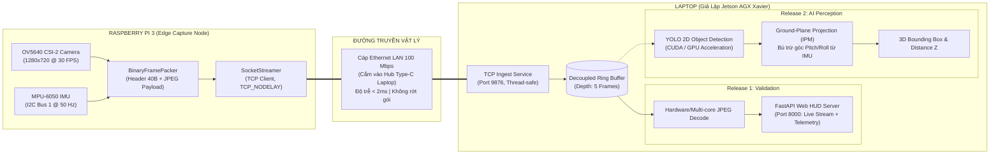
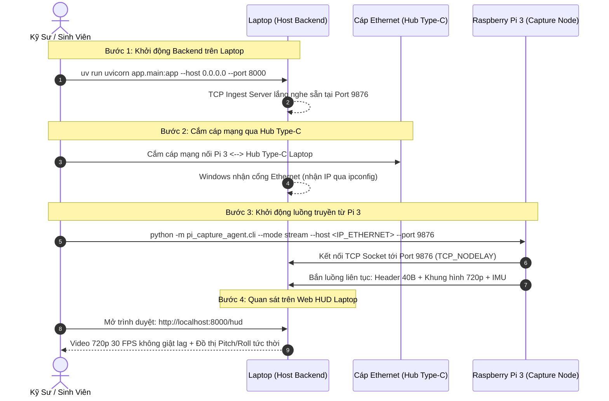

# Kế Hoạch Triển Khai Thực Chiến: Giả Lập Jetson Trên Laptop & Luồng Stream Ethernet Không Ma Sát

> **Tài liệu:** Implementation Layer (`docs/implementation/release-1/guide/06-laptop-simulation-and-ethernet-streaming-plan.md`)  
> **Phiên bản:** Release 1 $\to$ Release 2 Transition Plan  
> **Trạng thái:** Kế hoạch kỹ thuật & Kiến trúc phân tán (Distributed Architecture Plan)  
> **Mục tiêu:** Tách rời tải tính toán khỏi Raspberry Pi 3, biến Pi 3 thành Pure Edge Capture Node, dùng Laptop làm Digital Twin của Jetson AGX Xavier qua cáp Ethernet không phụ thuộc IP tĩnh.

---

## 1. Bối Cảnh & Phân Tích Điểm Nghẽn Kỹ Thuật

### 1.1. Hiện trạng trên Raspberry Pi 3 Model B+
Qua thực nghiệm thực tế với cảm biến Digilent Pcam 5C (OV5640) và IMU MPU-6050:
- Khi Pi 3 tự gánh toàn bộ quy trình: Chụp khung hình $\to$ Đổi màu UYVY sang BGR $\to$ Lật ma trận $\to$ Thu nhỏ ảnh $\to$ Nén JPEG phần mềm $\to$ Dựng HTTP server phục vụ Web Preview:
  - Tốc độ khung hình bị chặn cứng ở mức **~14.5 FPS**.
  - **1 nhân CPU của Cortex-A53 chạy 100% công suất** (do vướng Python Global Interpreter Lock - GIL).
- **Về đề xuất WebSocket:** WebSocket và MJPEG đều chạy trên nền giao thức truyền tải TCP. Việc chuyển sang WebSocket không làm giảm băng thông hay độ trễ, ngược lại còn làm tăng tải đóng gói frame WebSocket trên Pi 3 và ép JavaScript trên trình duyệt phải quản lý bộ nhớ đệm (Garbage Collection), gây giật khung hình.

### 1.2. Bản chất kiến trúc hệ thống Robot tự hành
Trong mô hình thực tế của đề tài:
* **Raspberry Pi 3** chỉ là **Sensor Gateway / Edge Capture Node**: Thu nhận byte thô từ phần cứng và đẩy đi nhanh nhất có thể.
* **Jetson AGX Xavier (hoặc Laptop phát triển)** là **Compute & Perception Host**: Sở hữu CPU đa nhân tốc độ cao và GPU chuyên dụng (CUDA/TensorRT/NVDEC) để đảm nhận toàn bộ khâu giải mã ảnh, suy luận Object Detection 2D/3D và giải bài toán hình học IPM.

👉 **Kết luận chiến lược:** Phải giải phóng hoàn toàn Pi 3 khỏi nhiệm vụ giải mã/xử lý ảnh. Mọi khâu tính toán nặng phải chuyển sang Laptop (đóng vai trò giả lập Jetson thật).

---

## 2. Kiến Trúc Phân Tán Hai Node (Distributed Two-Node Architecture)



### Bảng phân định trách nhiệm chi tiết:

| Tiêu chí | Raspberry Pi 3 (Capture Node) | Laptop / Jetson (Compute Host) |
| :--- | :--- | :--- |
| **Phần cứng sử dụng** | ARM Cortex-A53 @ 1.4 GHz (1GB RAM) | Intel/AMD đa nhân + NVIDIA GPU |
| **Tác vụ đảm nhiệm** | - Đọc DMA Unicam V4L2 từ camera (`buffer_size=4`)<br/>- Đọc góc Pitch/Roll từ I2C IMU (tách luồng riêng)<br/>- Nén JPEG đa nhân (3 Thread-Local Workers) & đóng gói 40 bytes<br/>- Bắn gói tin qua TCP Socket | - Nhận gói tin từ TCP Socket<br/>- Giải mã ảnh JPEG bằng đa nhân CPU/GPU<br/>- Cung cấp Web HUD cho người vận hành<br/>- *(Release 2)* Chạy suy luận YOLO + BBox 3D |
| **Tải CPU ước tính** | **~10% – 15%** (Chủ yếu là I/O mạng) | **~5% – 10%** của Laptop hiện đại |
| **Tốc độ khung hình** | Đạt cực đại của cảm biến (**25 – 30 FPS**) | Đồng bộ tức thời theo luồng nhận được |
| **Độ trễ truyền dẫn** | $< 2\text{ms}$ qua dây cáp Ethernet LAN | Hiển thị tức thời trên trình duyệt |

---

## 3. Chiến Lược Mạng Không Ma Sát (Zero-Friction Networking)

### 3.1. Thách thức cốt lõi
1. Người dùng cắm cáp Ethernet qua cổng chuyển đổi Hub Type-C vào nhiều máy khác nhau (Laptop cá nhân, Laptop của sinh viên, PC trên phòng Lab).
2. **Yêu cầu bắt buộc:** Tuyệt đối không cấu hình IP tĩnh (Static IP) cố định trên card mạng của máy tính để tránh xung đột mạng, tránh gây lỗi kết nối khi mang máy sang môi trường khác, và không đòi hỏi quyền Admin phức tạp.
3. Cáp Ethernet cắm trực tiếp (Peer-to-Peer) giữa Pi 3 và Hub Type-C mà không qua Router/Modem cấp DHCP.

### 3.2. Giải pháp cơ chế kết nối

#### Giải pháp 1: Cơ chế Tự cấu hình IPv4 Link-Local (APIPA RFC 3927) & mDNS
* Khi cắm cáp mạng trực tiếp giữa Pi 3 và Laptop mà không có DHCP Server:
  * Windows và Linux đều tự động kích hoạt giao thức **APIPA (Automatic Private IP Addressing)**.
  * Hai thiết bị sẽ tự cấp cho cổng Ethernet địa chỉ IP thuộc dải `169.254.x.x` với Subnet Mask `255.255.0.0` chỉ trong vòng 3–5 giây.
  * Giao thức **mDNS (Multicast DNS)** hoạt động sẵn trên cả Windows 10/11 và Raspberry Pi OS:
    * Pi 3 có thể tự động phân giải tên máy của Laptop qua cú pháp `<tên-máy-tính>.local`.
    * Laptop có thể tìm thấy Pi 3 qua tên miền `r3b.local`.

#### Giải pháp 2: Truyền tham số động qua CLI (Dynamic CLI Parameterization)
Thay vì hardcode IP máy tính vào file cấu hình `configs/capture_pi.yaml`:
* Tham số đích `--host` và `--port` được cung cấp linh hoạt ngay trên dòng lệnh CLI.
* Người dùng chỉ cần xem nhanh IP cổng Ethernet của máy tính đang cắm dây (qua 1 lệnh `ipconfig` trên Windows hoặc `ip a` trên Linux), rồi truyền trực tiếp khi khởi động Pi:
  ```bash
  python -m pi_capture_agent.cli --mode stream --host <IP_ETHERNET_LAPTOP> --port 9876
  ```

### 3.3. Bảng so sánh 2 chế độ vận hành (Dual Operating Modes)

| Đặc tính | Chế độ 1: Wi-Fi Diagnostic Preview (`--mode preview`) | Chế độ 2: Wi-Fi / Ethernet Binary Stream (`--mode stream`) |
| :--- | :--- | :--- |
| **Mục đích** | Kiểm tra nhanh camera & góc nghiêng IMU trực tiếp trên trình duyệt Laptop | Thu thập dữ liệu thực tế & cấp luồng cho Jetson/Laptop xử lý + Benchmark với C/C++ |
| **Đường truyền** | Mạng Wi-Fi không dây (hoặc Ethernet) | Cáp mạng Ethernet (Hub Type-C / Jetson LAN) hoặc Wi-Fi |
| **Độ phân giải** | Thu nhỏ $640 \times 360$ (`2x2` strided decimation), JPEG Q=65 | Độ phân giải gốc $1280 \times 720$ (HD) hoặc $640 \times 360$, JPEG Q=70 |
| **Tốc độ (FPS)** | **25 – 30 FPS thời gian thực** (Tách 3 luồng + `SO_SNDBUF=32KB`) | **26 – 30 FPS mượt mà** (4-stage pipeline, 3 Thread-Local Workers) |
| **Lệnh chạy Pi** | `python -m pi_capture_agent.cli --mode preview --preview-port 8080` | `python -m pi_capture_agent.cli --mode stream --host <IP_HOST> --port 9876` |
| **Phía Laptop** | Chỉ mở trình duyệt truy cập `http://<pi_ip>:8080` | Chạy `mock_ingest_server.py` hoặc Backend Ingest Server (`http://localhost:8000/hud`) |

---

## 4. Kịch Bản Vận Hành Thực Địa Từng Bước (Field Playbook)



### Các bước thao tác cụ thể:

#### Bước 1: Chạy Backend trên Laptop
Mở terminal trên Laptop (tại thư mục `services/backend`):
```powershell
# Chạy Backend Ingest Server với cấu hình port 9876
uv run uvicorn app.main:app --host 0.0.0.0 --port 8000
```
*Backend sẽ kích hoạt đồng thời:*
1. **TCP Ingest Daemon:** Mở cổng `0.0.0.0:9876` chờ nhận byte nhị phân từ Pi 3.
2. **FastAPI Web HUD:** Phục vụ giao diện giám sát tại `http://localhost:8000/hud`.

#### Bước 2: Cắm cáp mạng và lấy địa chỉ IP của Laptop
1. Cắm dây cáp mạng Ethernet từ cổng LAN của Raspberry Pi 3 vào Hub Type-C của Laptop.
2. Mở terminal trên Laptop và gõ:
   * Trên Windows: `ipconfig` (Tìm mục `Ethernet adapter` hoặc `vEthernet`, ghi nhận dòng `IPv4 Address`, ví dụ: `169.254.85.120` hoặc `192.168.x.x`).
   * Trên Linux/macOS: `ip a` hoặc `ifconfig`.

#### Bước 3: Bắn luồng từ Raspberry Pi 3
SSH vào Pi 3 (vẫn có thể SSH qua mạng Wi-Fi bình thường) và thực thi lệnh:
```bash
cd ~/workspaces/monocular-spatial-vision/services/pi_capture_agent
source .venv/bin/activate

# Khởi động stream qua cáp Ethernet trỏ về IP của Laptop
python -m pi_capture_agent.cli --mode stream --host <IP_ETHERNET_LAPTOP> --port 9876
```

#### Bước 4: Kiểm tra kết quả
Mở trình duyệt trên Laptop và truy cập:
```text
http://localhost:8000/hud
```
* **Kết quả quan sát:**
  * Khung hình hiển thị độ phân giải cao $1280 \times 720$ sắc nét.
  * Tốc độ đạt mượt mà **25 – 30 FPS**.
  * Độ trễ hiển thị thực tế dưới **50ms** (gần như tức thời theo chuyển động của tay trước camera).
  * Góc nghiêng Pitch, Roll từ cảm biến MPU-6050 nhảy đều đặn đồng bộ với từng khung hình.

---

## 5. Lộ Trình Tiến Tới Release 2 (3D Perception & Object Detection)

Khi mô hình truyền nhận qua cáp Ethernet giữa Pi 3 và Laptop đã hoạt động trơn tru ở Release 1, chúng ta sẽ bắt đầu **Release 2** với quy trình phát triển vô cùng thuận lợi:

```
[Release 1: Hoàn tất]
     │   Pi 3 truyền luồng nhị phân 30 FPS ổn định qua Ethernet về Laptop.
     ▼
[Release 2: Triển khai AI & 3D Geometry trên Laptop]
     │
     ├─ Bước 2.1: Tích hợp YOLO 2D Object Detection
     │   └─ Lấy trực tiếp frame BGR từ Ring Buffer của IngestService.
     │   └─ Trích xuất Bounding Box 2D và điểm tiếp xúc đáy (Bottom-center pixel).
     │
     ├─ Bước 2.2: Bù trừ góc nghiêng động (Dynamic Tilt Compensation)
     │   └─ Sử dụng chính xác góc Pitch (θ) và Roll (φ) từ Header 40B nhận được.
     │   └─ Tính toán cự ly chiều sâu trục Z và vị trí không gian 3D (X, Y, Z) qua hình học IPM.
     │
     ├─ Bước 2.3: Trực quan hóa Bounding Box 3D trên Web HUD Laptop
     │   └─ Vẽ Wireframe 3D Box phủ lên vật thể trong video.
     │   └─ Vẽ bản đồ nhìn từ trên cao (Bird's Eye View - BEV) đo khoảng cách thực tế.
     │
     ▼
[Chuyển giao 1-Click sang Jetson AGX Xavier Thật]
     │   Copy mã nguồn services/backend sang Jetson AGX.
     │   Biên dịch mô hình YOLO sang TensorRT engine (.engine).
     │   Pi 3 giữ nguyên 100% mã nguồn, chỉ cần đổi tham số: --host <IP_JETSON>.
     ▼
[Hoàn thành hệ thống thực địa tự hành]
```

---

## 6. Phân Tích Rủi Ro & Biện Pháp Dự Phòng (Risk Matrix)

| Rủi ro kỹ thuật | Mức độ | Nguyên nhân | Biện pháp xử lý dự phòng đã thiết kế |
| :--- | :---: | :--- | :--- |
| **Cáp mạng bị tuột hoặc Hub Type-C lỏng** | Trung bình | Chuyển động vật lý của robot/dây cắm | `SocketStreamer` trên Pi 3 đã tích hợp cơ chế **Exponential Backoff Auto-Reconnect**: Tự động thử kết nối lại liên tục mà không làm crash tiến trình. Khi cắm lại dây, luồng tự phục hồi trong $< 2\text{s}$. |
| **Windows Firewall chặn cổng 9876** | Thấp | Tường lửa mặc định của Windows từ chối kết nối lạ đến cổng TCP | Khi chạy `uvicorn` lần đầu trên Windows, bấm **Allow access** cho Private Networks. Hoặc mở port 9876 bằng lệnh PowerShell 1 dòng: `New-NetFirewallRule -DisplayName "Ingest-9876" -Direction Inbound -LocalPort 9876 -Protocol TCP -Action Allow`. |
| **Nhầm lẫn giữa IP Wi-Fi và IP Ethernet** | Thấp | Laptop kết nối cả Wi-Fi và cáp Ethernet cùng lúc | Nếu truyền nhầm IP Wi-Fi, hệ thống vẫn chạy nhưng qua đường Wi-Fi. Khi truyền đúng IP của cổng Ethernet, luồng sẽ chạy qua cáp với băng thông tối đa 100 Mbps. |
| **Độ trễ tích tụ nếu Laptop xử lý AI quá lâu** | Thấp | Xử lý AI trong Release 2 nặng hơn tốc độ nhận frame | `IngestService` trên Laptop sử dụng cấu trúc hàng đợi vòng **Ring Buffer (`maxlen=5`)**: Nếu AI xử lý chậm, các khung hình cũ sẽ tự động bị loại bỏ (drop oldest), đảm bảo thuật toán AI luôn nhận được khung hình mới nhất theo thời gian thực (Zero Lag). |

---

## 7. Kết Luận

Kế hoạch này đảm bảo 3 tiêu chí:
1. **Bảo toàn sự tiện lợi:** Giữ nguyên chế độ Preview Wi-Fi độc lập khi cần test nhanh không dây.
2. **Triệt tiêu điểm nghẽn:** Đưa Pi 3 về đúng vai trò Edge Node nhẹ nhàng, đạt trọn vẹn 30 FPS trên dây Ethernet.
3. **Linh hoạt tối đa:** Không can thiệp cấu hình IP tĩnh của bất kỳ máy tính nào; dễ dàng cắm vào bất kỳ máy tính nào của sinh viên hay phòng Lab; sẵn sàng 100% cho việc tích hợp mô hình AI trong Release 2 và chuyển giao sang Jetson AGX Xavier.
