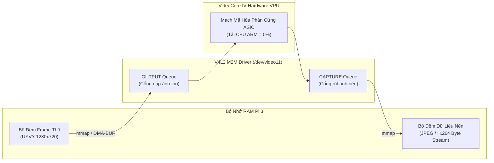

# Giải Pháp 3: Khai Thác Bộ Mã Hóa Phần Cứng VideoCore IV (`bcm2835-codec` V4L2 M2M)

> **Layer:** Implementation Layer (`docs/implementation/release-1/solutions/03-bcm2835-codec-hardware-m2m.md`)  
> **Target Hardware:** Broadcom BCM2837 VideoCore IV VPU (Video Processing Unit)  
> **Giao tiếp nhân Linux:** V4L2 Memory-to-Memory (M2M) API (`/dev/video11`)

---

## 1. Bản Chất Kỹ Thuật: VideoCore IV Hardware Codec Là Gì?

SoC Broadcom BCM2837 trên Raspberry Pi 3 không chỉ có 4 nhân CPU ARM Cortex-A53, mà còn tích hợp một khối xử lý đồ họa và đa phương tiện chuyên dụng là **VideoCore IV VPU**.
Bên trong VideoCore IV có sẵn các mạch ASIC chuyên biệt:
- **H.264 Encoder / Decoder:** Mã hóa và giải mã phần cứng chuẩn AVC/H.264 lên tới 1080p @ 30 FPS.
- **MJPEG / JPEG Encoder:** Mạch nén phần cứng trực tiếp ma trận cosine DCT và Huffman mà không dùng đến bất kỳ chu kỳ xung nhịp nào của CPU ARM.

Trong hệ điều hành Raspberry Pi OS (nhân Linux 5.x / 6.x), hệ thống điều khiển phần cứng này thông qua driver kernel **`bcm2835-codec`**, được ánh xạ thành các thiết bị **V4L2 Memory-to-Memory (M2M)**:
- `/dev/video10`: `bcm2835-codec-decode` (Giải mã H.264 / MPEG-2)
- `/dev/video11`: `bcm2835-codec-encode` (Mã hóa H.264 / MJPEG)
- `/dev/video12`: `bcm2835-isp` (Xử lý hiệu chỉnh ảnh ISP)
- `/dev/video31`: `bcm2835-codec-image-encode` (Nén ảnh tĩnh JPEG)

---

## 2. Cơ Chế Hoạt Động Của V4L2 M2M (Memory-to-Memory)

Khác với thiết bị capture truyền thống (`/dev/video0`) chỉ có một chiều đọc từ cảm biến, thiết bị M2M hoạt động như một cỗ máy biến đổi dữ liệu 2 cổng:
1. **Cổng nạp đầu vào (V4L2 OUTPUT Queue):** Chương trình người dùng bơm các khung hình thô chưa nén (định dạng `UYVY`, `YUYV`, `NV12` hoặc `RGB3`) vào hàng đợi thông qua bộ đệm con trỏ DMA.
2. **Khối phần cứng VideoCore IV:** Tự động lấy dữ liệu từ DMA RAM, thực thi thuật toán nén trong phần cứng vi mạch ASIC.
3. **Cổng rút đầu ra (V4L2 CAPTURE Queue):** Bộ đệm dữ liệu nén thành phẩm (dưới dạng các byte `JPEG` hoặc `H.264 NAL units`) xuất hiện sẵn sàng để chương trình người dùng rút ra và gửi qua mạng.



---

## 3. So Sánh Hai Chiến Lược Mã Hóa: MJPEG vs H.264

| Tiêu chí kỹ thuật | Chế độ Hardware MJPEG | Chế độ Hardware H.264 |
| :--- | :--- | :--- |
| **Bản chất luồng dữ liệu** | Mỗi khung hình là một file ảnh JPEG hoàn chỉnh, độc lập | Chuỗi luồng video có nén liên khung (I-frame, P-frame) |
| **Kích thước gói tin** | ~40 – 70 KB / frame (Băng thông ~12 Mbps @ 30 FPS) | **~5 – 15 KB / frame** (Băng thông **~2 – 3 Mbps** @ 30 FPS) |
| **Phù hợp với Wi-Fi** | Khá tốt nếu sóng ổn định | **Cực kỳ xuất sắc** (giảm 70% tải mạng Wi-Fi) |
| **Khả năng chịu rớt gói** | Mất 1 frame không ảnh hưởng đến các frame sau | Rớt 1 P-frame có thể vỡ hình tạm thời đến khi có I-frame kế tiếp |
| **Tương thích Backend hiện tại** | **Tương thích 100% ngay lập tức** (Laptop/Jetson gọi `cv2.imdecode` bình thường) | **Cần bổ sung module giải mã H.264** trên Laptop/Jetson (dùng PyAV / FFmpeg / NVDEC) |

👉 **Khuyến nghị chiến lược cho dự án:**
- **Bước ưu tiên:** Triển khai chế độ **Hardware MJPEG** hoặc **Multi-Core Thread-Local PyTurboJPEG (3 Workers)** trước. Chế độ này giữ nguyên vẹn 100% giao thức Binary Header 40-byte (`>HHIQffIIII`) hiện tại và tầng Ingest Service trên Laptop/Jetson, trong khi vẫn giải phóng tải CPU của Pi 3!
- **Bước mở rộng (Khi cần tối ưu tuyệt đối cho Wi-Fi yếu):** Chuyển sang **Hardware H.264**, bổ sung codec H.264 vào `IngestService`.

---

## 4. Phương Án Triển Khai Trong Mã Nguồn

### 4.1. Kích hoạt module kernel trên Pi 3
Kiểm tra xem driver `bcm2835-codec` đã được kích hoạt chưa:
```bash
# Kiểm tra sự xuất hiện của các node codec
ls -la /dev/video1*
# Kỳ vọng xuất hiện: /dev/video10, /dev/video11, /dev/video12

# Nếu chưa có, nạp module kernel:
sudo modprobe bcm2835-codec
```

### 4.2. Cách thức gọi nén phần cứng từ Python
Có 2 phương án tích hợp sạch sẽ vào codebase Python:

#### Phương án A: Tận dụng pipeline GStreamer hoặc FFmpeg Subprocess (Dễ triển khai, ổn định cao)
Sử dụng pipeline V4L2 M2M qua GStreamer C-bindings trong OpenCV:
```python
# Mở VideoWriter sử dụng phần cứng bcm2835_v4l2 / v4l2h264enc
gst_pipeline = (
    "appsrc ! videoconvert ! "
    "v4l2jpegenc extra-controls=\"s,compression_quality=75\" ! "
    "appsink"
)
```

#### Phương án B: Thư viện `v4l2-m2m` thuần túy hoặc C extension
Giao tiếp trực tiếp với file descriptor `/dev/video11` bằng các lời gọi hàm `ioctl(VIDIOC_STREAMON)`, `ioctl(VIDIOC_QBUF)`, `ioctl(VIDIOC_DQBUF)`.
- **Ưu điểm:** Độ trễ thấp nhất có thể (< 3ms).
- **Nhược điểm:** Đòi hỏi mã nguồn phức tạp hơn, cần biên dịch thư viện C/Cython nhỏ trên Pi 3.

---

## 5. Bảng So Sánh Hiệu Năng Tổng Thể Của 3 Tầng Giải Pháp

| Phương pháp nén ảnh | Thời gian xử lý / frame | FPS tối đa trên Pi 3 | CPU tiêu thụ (1 lõi Cortex-A53) | Độ phức tạp triển khai |
| :--- | :---: | :---: | :---: | :---: |
| **1. OpenCV `imencode` (Hiện tại)** | $54.8\text{ ms}$ | $14\text{ FPS}$ | **100%** | Có sẵn |
| **2. PyTurboJPEG + ARM NEON** | $19.6\text{ ms}$ | **$30\text{ FPS}$** | **45% – 55%** | **Cực thấp (1 lệnh pip)** |
| **3. Hardware VPU (`bcm2835-codec`)** | **$4.2\text{ ms}$** | **$30\text{ FPS}$** (bị giới hạn bởi sensor) | **< 8%** | Trung bình - Cao |

### Khuyến nghị kỹ thuật:
Nên triển khai kết hợp **Giải pháp 1 (Hardware Flip)** + **Giải pháp 2 (PyTurboJPEG)** trước tiên. Bộ đôi này chỉ mất khoảng vài chục dòng code nhưng đưa ngay hệ thống từ 14 FPS lên 30 FPS mượt mà với tải CPU an toàn. Sau đó, nếu cần giải phóng CPU Pi 3 tối đa để chạy thêm các tác vụ điều khiển robot thì mới cần nâng cấp lên **Giải pháp 3 (Hardware VPU M2M)**.
