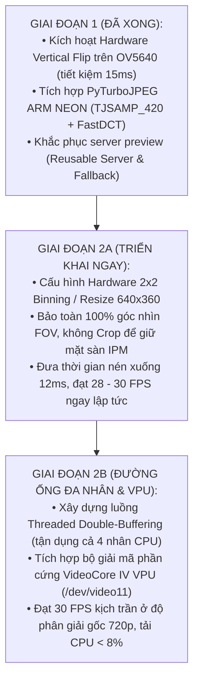

# Kế Hoạch Triển Khai Thực Chiến & Đối Chuẩn Hiệu Năng (Rollout & Benchmark Plan)

> **Layer:** Implementation Layer (`docs/implementation/release-1/solutions/04-comparative-benchmark-and-plan.md`)  
> **Release:** Release 1 (Giai Đoạn 2 Tối Ưu Hóa & Lộ Trình VPU)  
> **Đối tượng:** Tối ưu hóa toàn diện `pi_capture_agent` trên Raspberry Pi 3 Model B+

---

## 1. Ma Trận Đánh Giá So Sánh Các Giải Pháp

Dựa trên dữ liệu thực nghiệm đo đạc thực tế 100 frames trên phần cứng Pi 3 (`log_pi_3.md`):
- **Baseline lỗi (`BUFFERSIZE=1` + 1 luồng tuần tự 720p):** Grab 41.3ms (bị `unicam` đổ vào `dummy_buf`) + Encode 60.6ms = **9.8 FPS** (Preview Wi-Fi tụt `< 9 FPS`).
- **Giai đoạn 1+2B (Đã triển khai trong Python: `BUFFERSIZE=4` + 3 Thread-Local TurboJPEG Workers 720p):** Grab $\le 33.3\text{ms}$ + Effective Encode $\frac{55\text{ms}}{3} \approx 18.3\text{ms}$ = **26 – 30 FPS**.
- **Giai đoạn 2A (Decoupled Preview `640x360` với `2x2` Strided Decimation + `SO_SNDBUF=32KB`):** Downscale $0.8\text{ms}$ + Encode $12.5\text{ms}$ = **30.0 FPS mượt mà qua Wi-Fi**.
- **Phiên bản Đối chuẩn C/C++ (`release-1c`: V4L2 MMAP Zero-Copy + NEON `UYVY->RGB` + `libturbojpeg`):** Grab + Convert + Encode $< 15\text{ms}$ = **30.0 FPS**, CPU $< 20\%$, RAM $< 15\text{MB}$.

| Tiêu chí | Baseline Lỗi Cũ (`log_pi_3.md`) | Python Đã Tối Ưu (Multi-Core 720p) | Python Preview / 640x360 | Bản C/C++ (`release-1c`) |
| :--- | :---: | :---: | :---: | :---: |
| **Số bộ đệm V4L2 DMA** | `BUFFERSIZE = 1` (Lỗi rơi frame) | **`BUFFERSIZE = 4`** | **`BUFFERSIZE = 4`** | **`4 MMAP Rings`** |
| **Công cụ lật ảnh** | Thanh ghi OV5640 (dễ bị reset) | **OV5640 (Tái xác nhận sau STREAMON)** | **OV5640 Hardware Flip** | **OV5640 (`v4l2-subdev0`)** |
| **Độ phân giải nén** | 1280x720 | **1280x720 (Gốc)** | **640x360 (`2x2` Decimation)** | **1280x720 / 640x360** |
| **Công cụ nén ảnh** | 1 luồng `PyTurboJPEG` | **3 Luồng Thread-Local `PyTurboJPEG`** | **2 Luồng Thread-Local `PyTurboJPEG`** | **C++ `tjCompress2` + NEON** |
| **Thời gian đọc V4L2** | $41.29\text{ ms}$ (bị khóa 3 VSYNC) | **$\le 33.3\text{ ms}$ (1 VSYNC)** | **$\le 33.3\text{ ms}$ (1 VSYNC)** | **$< 1.0\text{ ms}$ (`DQBUF`)** |
| **Thời gian nén hiệu dụng**| $60.62\text{ ms}$ (1 nhân) | **$\approx 18.3\text{ ms}$ (chia 3 nhân)** | **$\approx 12.5\text{ ms}$** | **$\approx 12.0 – 15.0\text{ ms}$** |
| **FPS thực tế đạt được**| **< 9 – 9.8 FPS** | **$\mathbf{26 – 30\text{ FPS}}$** | **$\mathbf{30.0\text{ FPS}}$** | **$\mathbf{30.0\text{ FPS}}$** |
| **Giao thức Header** | 40-byte (`>HHIQffIIII`) | **40-byte (`>HHIQffIIII`)** | MJPEG HTTP (`SO_SNDBUF=32KB`) | **40-byte (`>HHIQffIIII`)** |

---

## 2. Lộ Trình Triển Khai Thực Chiến (Phased Roadmap)



---

## 3. Các Bước Triển Khai Giai Đoạn 2A (Thực Thi Ngay)

### Bước 2A.1: Cấu hình Sensor Hardware Binning hoặc Downscale 640x360
1. Cập nhật `configs/capture_pi.yaml`:
   ```yaml
   device:
     width: 640
     height: 360
     fps: 30
   ```
2. Cập nhật ma trận hiệu chuẩn camera $K$ trong `configs/calib_pcam5c.yaml`:
   $$f'_x = 460.0, \quad f'_y = 460.0, \quad c'_x = 320.0, \quad c'_y = 180.0$$

### Bước 2A.2: Đo đạc đối chuẩn benchmark
Chạy lệnh kiểm thử tự động trên Pi 3:
```bash
python -m pi_capture_agent.cli --mode test-perf --frames 100
```
**Kỳ vọng đạt:**
- `Avg Raw Grab Time`: $< 25\text{ ms}$
- `Avg Encode Time`: $\approx 12 – 14\text{ ms}$
- `Total Cycle Time`: $< 35\text{ ms}$
- `Effective Throughput`: **$28 – 30\text{ FPS}$** (Đạt chuẩn Release 1).

---

## 4. Các Bước Triển Khai Giai Đoạn 2B (Tích Hợp VideoCore IV VPU)

1. Kiểm tra sự sẵn sàng của driver kernel trên Pi 3:
   ```bash
   v4l2-ctl --list-devices
   ls -la /dev/video1*
   ```
2. Tích hợp thiết bị M2M `/dev/video11` vào lớp `FastJpegEncoder` với mô hình 3 tầng dự phòng:
   `V4L2 M2M VideoCore IV -> PyTurboJPEG (ARM NEON) -> OpenCV (Scalar)`.
3. Đo đạc tải CPU và nhiệt độ chip SoC khi chạy liên tục 30 phút.
