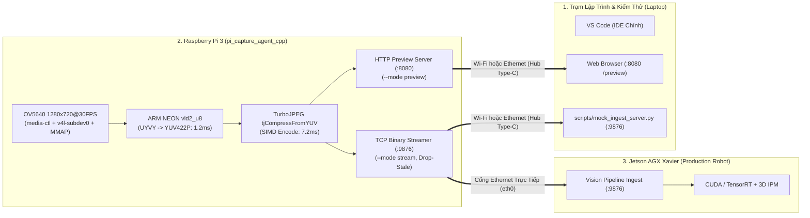

# Release 1c: Tổng Quan Quy Trình Phát Triển Thực Chiến C/C++ & Vận Hành Đa Phương Thức

> **Layer:** Implementation Layer (`docs/implementation/release-1c/guidec/00-overview-and-dev-workflow.md`)  
> **Release:** Release 1c (C/C++ Native Edge Capture & Perception Pipeline)  
> **Status:** Approved Baseline — Practical Engineering Standard (Audit-Remediated)  

---

## 1. Triết Lý Phát Triển: Tối Ưu Hóa C++ Nhưng Giữ Nguyên 100% Trải Nghiệm Kiểm Thử

Khi chuyển đổi tác tử thu nhận trên Raspberry Pi 3 từ Python sang C/C++ (`services/pi_capture_agent_cpp/`), chúng ta giải quyết triệt để nút thắt cổ chai CPU/GIL nhưng **tuyệt đối không cắt bỏ sự tiện lợi trong quy trình kiểm thử và tích hợp phần cứng**:

1. **Giữ nguyên cả 2 giao thức truyền dẫn (Wi-Fi & Cổng Ethernet):**
   - **Wi-Fi (`wlan0`):** Dùng để kiểm thử không dây nhanh chóng với Laptop của kỹ sư thông qua cả trình duyệt Web (`--mode preview` tại cổng `8080`) lẫn luồng TCP nhị phân (`--mode stream` tại cổng `9876`).
   - **Cổng Ethernet (`eth0`):**
     - **Khi test với Laptop:** Kết nối dây mạng RJ45 từ Pi 3 qua **Hub chuyển đổi USB Type-C sang Ethernet** cắm vào Laptop. Hệ thống hỗ trợ Zero-Friction Networking (tự động hoạt động qua IP APIPA `169.254.x.x`, tên miền mDNS `raspberrypi.local`, hoặc tham số `--host <IP>` mà không bắt buộc phải đổi IP tĩnh của Laptop).
     - **Khi tích hợp thực tế trên Robot:** Kết nối dây mạng RJ45 trực tiếp từ Pi 3 sang cổng Gigabit Ethernet của **Jetson AGX Xavier (`192.168.1.20`)**.
2. **Giữ nguyên đủ 6 chế độ vận hành CLI (`--mode`):**
   - `diag`, `snapshot`, `test-imu`, `preview`, `stream`, `test-perf` tương thích 1:1 với bản Python.
3. **Biên dịch Native trực tiếp trên Pi 3 với `uv` + `Conan 2.0`:**
   - Viết code trên **VS Code (Windows)** $\to$ `git push` $\to$ `git pull` trên Pi 3 $\to$ Build native trong môi trường cô lập `.venv` + `.conan/`, không cần cài đặt cross-compiler phức tạp trên Windows.



---

## 2. Bảng Ma Trận Các Phương Thức Kết Nối & Kiểm Thử Chuẩn

| Kịch bản sử dụng | Giao tiếp vật lý | Thiết bị nhận | Chế độ CLI trên Pi 3 | Công cụ nhận phía Laptop / Jetson |
| :--- | :--- | :--- | :--- | :--- |
| **1. Xem nhanh Camera + Góc nghiêng IMU không dây** | **Wi-Fi (`wlan0`)** | Laptop | `--mode preview --port 8080` | Trình duyệt Web: `http://<PI_WIFI_IP>:8080/preview` |
| **2. Test luồng Stream nhị phân không dây** | **Wi-Fi (`wlan0`)** | Laptop | `--mode stream --host <LAPTOP_WIFI_IP> --port 9876` | `uv run python scripts/mock_ingest_server.py --host 0.0.0.0 --port 9876` |
| **3. Test có dây băng thông cao với Laptop** | **Ethernet (`eth0`) qua Hub USB Type-C** | Laptop | `--mode preview` hoặc `--mode stream --host <LAPTOP_ETH_IP> --port 9876` | Trình duyệt Web hoặc `scripts/mock_ingest_server.py` (Hỗ trợ APIPA `169.254.x.x` / DHCP) |
| **4. Tích hợp thực tế trên Robot** | **Ethernet (`eth0`) nối thẳng** | **Jetson AGX Xavier** | `--mode stream --host 192.168.1.20 --port 9876` | `services/vision_pipeline/ingest_service.py` + `services/backend/` |

---

## 3. Chi Tiết Các Bước Trong Vòng Lặp Phát Triển (Dev Loop)

### Bước 1: Viết Code & Kiểm Soát Kiểu Trên Windows (VS Code)
- Mở thư mục dự án `monocular-spatial-vision` trên VS Code (Windows).
- Chỉnh sửa code trong `services/pi_capture_agent_cpp/` hoặc cấu hình `configs/capture_pi.yaml`.
- Thực hiện commit và đẩy lên Git:
  ```bash
  git add services/pi_capture_agent_cpp/
  git commit -m "feat(US-C01): implement v4l2 mmap neon deinterleave and dual transport"
  git push origin main
  ```

---

### Bước 2: Đồng Bộ & Build Native Trên Raspberry Pi 3
- Mở terminal kết nối SSH vào Pi 3 (qua Wi-Fi hoặc qua dây Ethernet gắn Hub Type-C như `ssh pi@raspberrypi.local`):
  ```bash
  cd ~/workspaces/monocular-spatial-vision
  git pull origin main
  ```
- Kích hoạt môi trường ảo tại thư mục gốc và biên dịch bên trong `services/pi_capture_agent_cpp/`:
  ```bash
  # 1. Kích hoạt môi trường uv và đặt cache Conan cục bộ
  source .venv/bin/activate
  export CONAN_HOME="$(pwd)/.conan"

  # 2. Di chuyển vào thư mục dịch vụ C++
  cd services/pi_capture_agent_cpp

  # 3. Kéo thư viện và sinh CMake toolchain vào thư mục build/
  uv run conan install . --output-folder=build --build=missing -s build_type=Release

  # 4. Cấu hình và biên dịch bằng CMake (Giới hạn tối đa 2 luồng -j2)
  cmake -B build -DCMAKE_TOOLCHAIN_FILE=build/build/Release/generators/conan_toolchain.cmake -DCMAKE_BUILD_TYPE=Release
  cmake --build build -j2
  ```

---

### Bước 3: Chạy Kiểm Thử & Vận Hành Đầy Đủ Các Chế Độ

#### A. Chẩn đoán phần cứng & Benchmark tại chỗ (`diag`, `snapshot`, `test-imu`, `test-perf`)
```bash
# Kiểm tra đường ống Media Controller, /dev/video0, /dev/v4l-subdev0 và /dev/i2c-1
./build/bin/pi_capture_agent_cpp --mode diag

# Chụp thử 1 tấm ảnh tĩnh 1280x720 kiểm tra tiêu cự & lật ảnh phần cứng
./build/bin/pi_capture_agent_cpp --mode snapshot --out /tmp/test_720p.jpg

# Kiểm tra góc nghiêng IMU 50Hz
./build/bin/pi_capture_agent_cpp --mode test-imu

# Benchmark hiệu năng thực tế 100 khung hình 720p @ 30 FPS
./build/bin/pi_capture_agent_cpp --mode test-perf --frames 100
```
*Kỳ vọng đầu ra terminal của `--mode test-perf` (tách bạch thời gian chờ VSYNC phần cứng và thời gian CPU hoạt động thực tế):*
```text
[INFO] Media Controller /dev/media0 configured: 'ov5640 10-003c':0 [UYVY8_1X16 1280x720@30]
[INFO] Sub-device /dev/v4l-subdev0: V4L2_CID_VFLIP=1 ACTIVE (Silicon Vertical Flip)
[INFO] V4L2 Device /dev/video0 opened: 1280x720 @ 30 FPS, fmt=UYVY (4 MMAP buffers)
[INFO] TurboJPEG ARM NEON SIMD Encoder initialized (tjCompressFromYUV, TJSAMP_422, Q=70)
Avg VSYNC Poll Wait:       23.71 ms (Sensor 30 FPS pacing: 33.33 ms/frame)
Avg NEON UYVY->YUV422P:     1.24 ms (VIDIOC_QBUF returned immediately)
Avg TurboJPEG Encode:       8.38 ms
Total Active CPU / Frame:   9.62 ms
Effective Frame Rate:      30.00 FPS (100 frames in 3.33 s, 0 dropped)
Avg Payload:               52.3 KB | CPU Usage: 18.4% | RSS Memory: 24.6 MB
```

#### B. Kiểm thử Preview trên trình duyệt Laptop qua Wi-Fi hoặc dây Ethernet (Hub Type-C)
```bash
./build/bin/pi_capture_agent_cpp --mode preview --port 8080
```
- Mở trình duyệt trên Laptop truy cập `http://<PI_WIFI_OR_ETH_IP>:8080/preview` để xem trực tiếp video MJPEG kèm góc nghiêng IMU.

#### C. Kiểm thử Stream nhị phân TCP tới Laptop (qua Wi-Fi hoặc dây Ethernet + Hub Type-C)
- Trên Laptop:
  ```bash
  uv run python scripts/mock_ingest_server.py --host 0.0.0.0 --port 9876
  ```
- Trên Pi 3 (chọn IP Wi-Fi của Laptop hoặc IP cổng Ethernet Hub Type-C của Laptop):
  ```bash
  ./build/bin/pi_capture_agent_cpp --mode stream --host <LAPTOP_IP> --port 9876
  ```

#### D. Tích hợp thực tế với Jetson AGX Xavier qua cổng Ethernet
```bash
./build/bin/pi_capture_agent_cpp --mode stream --host 192.168.1.20 --port 9876
```
