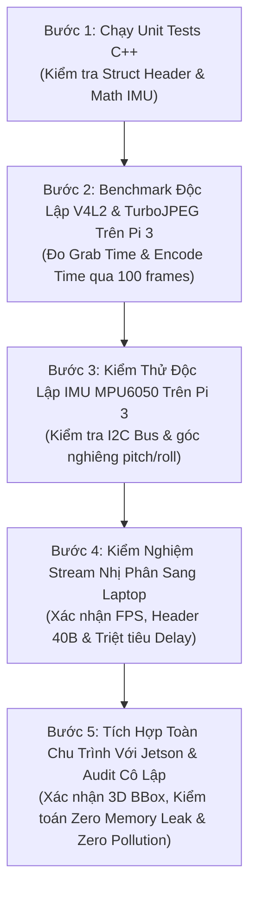

# Release 1c: Kế Hoạch Kiểm Thử Tích Hợp Từng Bước (5-Step Integration Plan)

> **Layer:** Implementation Layer (`docs/implementation/release-1c/guidec/04-step-by-step-integration-and-testing-plan.md`)  
> **Release:** Release 1c (C/C++ Native Edge Capture & Perception Pipeline)  
> **Status:** Approved Baseline — Practical Engineering Standard  

---

## 1. Nguyên Tắc Kiểm Thử: Phân Lập Để Kiểm Chứng (Isolation Verification)

Để loại trừ việc đổ lỗi chéo giữa các tầng phần cứng và phần mềm, quá trình kiểm thử cho phiên bản C++ Release 1c tuân thủ nghiêm ngặt lộ trình **5 bước tuần tự từ cô lập thành phần đến tích hợp toàn chu trình**:



---

## 2. Chi Tiết Từng Bước Triển Khai Kiểm Thử

### Bước 1: Chạy Unit Tests C++ Tại Chỗ
- **Mục tiêu:** Đảm bảo cấu trúc nhị phân và các hàm toán học hoạt động đúng mà không cần phần cứng camera thật.
- **Thực hiện trên Pi 3 hoặc Laptop:**
  ```bash
  cd ~/workspaces/monocular-spatial-vision
  ctest --test-dir build --output-on-failure
  ```
- **Tiêu chuẩn vượt qua (Pass Criteria):**
  - Kích thước `PackedFrameHeader` đạt chính xác $40\text{ bytes}$.
  - Hoán vị byte Big-Endian của các trường số thực và số nguyên chuẩn xác.
  - Toàn bộ unit tests đạt kết quả $100\%$ Passed.

---

### Bước 2: Benchmark Độc Lập V4L2 & TurboJPEG Trên Pi 3
- **Mục tiêu:** Đo tốc độ bắt hình và nén ảnh thực tế trên phần cứng Raspberry Pi 3 mà không bị phụ thuộc vào mạng.
- **Lệnh thực hiện:**
  ```bash
  ./build/bin/pi_capture_agent_cpp --mode test-perf --frames 100
  ```
- **Tiêu chuẩn vượt qua:**
  - `Avg Grab Time`: $\le 3.5\text{ms}$.
  - `Avg Encode Time`: $\le 11.0\text{ms}$.
  - `Throughput`: Đạt từ **$25.0 - 30.0\text{ FPS}$** liên tục.
  - Tải CPU tổng thể: $\le 25\%$.

---

### Bước 3: Kiểm Thử Độc Lập IMU MPU6050 Trên Pi 3
- **Mục tiêu:** Kiểm tra giao tiếp I2C không bị nghẽn và số đo góc nghiêng phản hồi đúng chiều vật lý.
- **Lệnh thực hiện:**
  ```bash
  ./build/bin/pi_capture_agent_cpp --mode test-imu
  ```
- **Tiêu chuẩn vượt qua:**
  - Terminal in liên tục các giá trị `Pitch` và `Roll` với tần số ổn định $50\text{Hz}$.
  - Nghiêng board về phía trước: Góc pitch $\theta$ đổi dấu và tăng giảm mượt mà.
  - Không có hiện tượng rớt bus I2C (`I2C read failed`).

---

### Bước 4: Kiểm Nghiệm Stream Nhị Phân Sang Laptop
- **Mục tiêu:** Xác minh tính năng truyền mạng, đóng gói gói tin và triệt tiêu độ trễ hiển thị.
- **Chuẩn bị trên Laptop:** Khởi động kịch bản nhận stream kiểm thử:
  ```bash
  python tools/laptop/mock_ingest_server.py --port 9876
  ```
- **Thực hiện trên Pi 3:**
  ```bash
  ./build/bin/pi_capture_agent_cpp --mode stream --host 192.168.1.100 --port 9876
  ```
- **Tiêu chuẩn vượt qua:**
  - Cửa sổ hình ảnh trên Laptop mở ra mượt mà ở tốc độ $\ge 25\text{ FPS}$.
  - Khi người thử nghiệm vẫy tay trước ống kính, hình ảnh hiển thị trên Laptop phản hồi ngay lập tức, độ trễ cảm nhận bằng mắt thường $< 30\text{ms}$ (hoàn toàn triệt tiêu hiện tượng delay 2 giây của bản Python).
  - Thử rút cáp Ethernet hoặc tắt script Laptop: Tiến trình C++ trên Pi 3 in log thử kết nối lại (Auto-reconnect) mà không bị crash. Khi mở lại script Laptop, luồng video tự động phục hồi trong $\le 2\text{ giây}$.

---

### Bước 5: Tích Hợp Toàn Chu Trình Với Jetson & Audit Cô Lập

#### 1. Kiểm thử End-to-End với Jetson AGX Xavier
- Khởi động service backend trên Jetson:
  ```bash
  cd services/backend && uv run uvicorn app.main:app --host 0.0.0.0 --port 8000
  ```
- Pi 3 stream sang Jetson:
  ```bash
  ./build/bin/pi_capture_agent_cpp --mode stream --host 192.168.1.20 --port 9876
  ```
- Mở Web HUD trên Laptop (`http://192.168.1.20:8000/hud`): Xác nhận hình ảnh hiển thị 3D Bounding Box và góc nghiêng IMU đầy đủ.

#### 2. Kiểm toán Rò Rỉ Bộ Nhớ (Memory Leak Check)
Chạy kiểm tra với công cụ AddressSanitizer hoặc Valgrind:
```bash
valgrind --tool=memcheck --leak-check=full ./build/bin/pi_capture_agent_cpp --mode test-perf --frames 200
```
- **Tiêu chuẩn:** `definitely lost: 0 bytes in 0 blocks`.

#### 3. Kiểm toán Cô Lập Môi Trường (Zero-Pollution Audit)
```bash
# Đảm bảo toàn bộ artifacts nằm trong repo
git status --ignored
# Xác nhận chỉ có các thư mục .venv, .conan, build bị git ignore
```
Sau khi hoàn tất cả 5 bước trên, bản release C++ được coi là hoàn thiện và sẵn sàng đưa vào vận hành chính thức trên robot.
