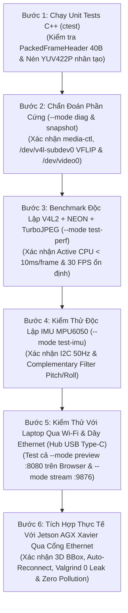

# Release 1c: Kế Hoạch Kiểm Thử Tích Hợp Từng Bước (Wi-Fi, Ethernet Type-C Hub & Jetson)

> **Layer:** Implementation Layer (`docs/implementation/release-1c/guidec/04-step-by-step-integration-and-testing-plan.md`)  
> **Release:** Release 1c (C/C++ Native Edge Capture & Perception Pipeline)  
> **Status:** Approved Baseline — Practical Engineering Standard (Audit-Remediated)  

---

## 1. Nguyên Tắc Kiểm Thử: Phân Lập Thành Phần & Giữ Nguyên Trải Nghiệm Kiểm Thử

Quá trình kiểm thử cho phiên bản C++ Release 1c tuân thủ nghiêm ngặt lộ trình **6 bước tuần tự** và đảm bảo kiểm chứng đầy đủ **cả 2 giao thức truyền dẫn (Wi-Fi & Ethernet)** lẫn **cả 2 phương thức test trên Laptop (`--mode preview` và `--mode stream`)** trước khi cắm vào Jetson AGX Xavier:



---

## 2. Chi Tiết Từng Bước Triển Khai Kiểm Thử

### Bước 1: Chạy Unit Tests C++ Tại Chỗ
- **Mục tiêu:** Đảm bảo cấu trúc nhị phân 40 bytes (`std::memcpy` float packing, Big-Endian) và hàm tách kênh NEON + nén `tjCompressFromYUV` hoạt động đúng mà chưa cần phần cứng camera thật.
- **Thực hiện trên Pi 3 hoặc Laptop:**
  ```bash
  cd ~/workspaces/monocular-spatial-vision/services/pi_capture_agent_cpp
  ctest --test-dir build --output-on-failure
  ```
- **Tiêu chuẩn vượt qua (Pass Criteria):**
  - `sizeof(PackedFrameHeader) == 40`.
  - Giải mã bằng Python `struct.unpack(">HHIQffIIII", buf)` khớp 100% đến chữ số thập phân thứ 5 của `pitch_deg` và `roll_deg`.
  - Toàn bộ unit tests đạt kết quả $100\%$ Passed.

---

### Bước 2: Chẩn Đoán Phần Cứng (`--mode diag` & `--mode snapshot`)
- **Mục tiêu:** Xác nhận đường ống `bcm2835-unicam` (`/dev/media0`, `/dev/v4l-subdev0`, `/dev/video0`) và lật ảnh dọc phần cứng (`V4L2_CID_VFLIP=1`) hoạt động chuẩn xác.
- **Lệnh thực hiện:**
  ```bash
  ./build/bin/pi_capture_agent_cpp --mode diag
  ./build/bin/pi_capture_agent_cpp --mode snapshot --out /tmp/snapshot_720p.jpg
  ```
- **Tiêu chuẩn vượt qua:**
  - `--mode diag` báo `PASS` cho `/dev/media0`, `/dev/v4l-subdev0`, `/dev/video0` và `/dev/i2c-1 (0x68)`.
  - Ảnh `/tmp/snapshot_720p.jpg` có độ phân giải $1280 \times 720$, chiều ảnh thuận (đã được lật bởi cảm biến OV5640).

---

### Bước 3: Benchmark Độc Lập V4L2 + NEON + TurboJPEG Trên Pi 3 (`--mode test-perf`)
- **Mục tiêu:** Đo tốc độ tách kênh NEON và nén ảnh thực tế trên phần cứng Raspberry Pi 3 qua 100 khung hình.
- **Lệnh thực hiện:**
  ```bash
  ./build/bin/pi_capture_agent_cpp --mode test-perf --frames 100
  ```
- **Tiêu chuẩn vượt qua:**
  - `Avg NEON UYVY->YUV422P`: $\le 2.0\text{ms}$ (mục tiêu $\approx 1.24\text{ms}$).
  - `Avg TurboJPEG Encode`: $\le 10.0\text{ms}$ (mục tiêu $\approx 8.38\text{ms}$).
  - `Total Active CPU / Frame`: $\le 12.0\text{ms}$ (mục tiêu $\approx 9.62\text{ms}$).
  - `Effective Frame Rate`: Đạt chuẩn **$30.0\text{ FPS}$** (100 khung hình hoàn tất trong $\approx 3.33\text{ giây}$ theo nhịp VSYNC của cảm biến).
  - Tải CPU tổng thể: $\le 25\%$.

---

### Bước 4: Kiểm Thử Độc Lập IMU MPU6050 Trên Pi 3 (`--mode test-imu`)
- **Mục tiêu:** Kiểm tra giao tiếp I2C không bị nghẽn và số đo góc nghiêng phản hồi đúng chiều vật lý.
- **Lệnh thực hiện:**
  ```bash
  ./build/bin/pi_capture_agent_cpp --mode test-imu
  ```
- **Tiêu chuẩn vượt qua:**
  - Terminal in liên tục các giá trị `Pitch` và `Roll` với tần số ổn định $50\text{Hz}$.
  - Khi nghiêng board về phía trước/sau hoặc trái/phải, góc `pitch_deg` và `roll_deg` phản hồi mượt mà, không có lỗi `I2C read failed`.

---

### Bước 5: Kiểm Thử Toàn Diện Với Laptop Qua Cả Wi-Fi Lẫn Dây Ethernet (Hub USB Type-C)

Bước này bắt buộc kiểm tra đầy đủ **cả 2 phương thức truyền vật lý (Wi-Fi & Ethernet qua Hub Type-C)** với **cả 2 chế độ (`preview` & `stream`)** giống hệt phiên bản Python:

#### 5.1. Kịch bản A: Kiểm thử không dây qua Wi-Fi (`wlan0`) với Laptop
1. **Test chế độ xem trực tiếp trên trình duyệt (`--mode preview`):**
   - Trên Pi 3:
     ```bash
     ./build/bin/pi_capture_agent_cpp --mode preview --port 8080
     ```
   - Trên Laptop (cùng mạng Wi-Fi): Mở trình duyệt tại `http://<PI_WIFI_IP>:8080/preview`.
   - **Tiêu chuẩn:** Video MJPEG (`640x360`) và thông số góc nghiêng IMU cập nhật mượt mà theo thời gian thực.
2. **Test chế độ truyền luồng nhị phân TCP (`--mode stream`):**
   - Trên Laptop, chạy script nhận luồng chuẩn của dự án:
     ```bash
     uv run python scripts/mock_ingest_server.py --host 0.0.0.0 --port 9876
     ```
   - Trên Pi 3:
     ```bash
     ./build/bin/pi_capture_agent_cpp --mode stream --host <LAPTOP_WIFI_IP> --port 9876
     ```
   - **Tiêu chuẩn:** Server trên Laptop giải mã chính xác Header 40-byte (`magic=0x5043`), hiển thị tốc độ $15 - 30\text{ FPS}$ tùy chất lượng sóng Wi-Fi, hoàn toàn không có độ trễ tích lũy (Drop-Stale hoạt động đúng).

#### 5.2. Kịch bản B: Kiểm thử có dây qua cáp Ethernet + Hub chuyển đổi USB Type-C với Laptop
1. Cắm cáp mạng RJ45 từ cổng Ethernet của Pi 3 vào **Hub chuyển đổi USB Type-C sang Ethernet** trên Laptop.
2. **Zero-Friction Networking:** Không cần cấu hình Static IP phức tạp trên Laptop — lấy địa chỉ IP tự động của card mạng Type-C Ethernet trên Laptop (dải Link-Local APIPA `169.254.x.x` hoặc DHCP):
   - Trên Windows Laptop: `ipconfig` (xem mục Ethernet adapter của USB Type-C Hub).
3. Test lần lượt cả `--mode preview` (`http://raspberrypi.local:8080/preview` hoặc `http://<PI_ETH_IP>:8080/preview`) và `--mode stream`:
   - Trên Laptop:
     ```bash
     uv run python scripts/mock_ingest_server.py --host 0.0.0.0 --port 9876
     ```
   - Trên Pi 3:
     ```bash
     ./build/bin/pi_capture_agent_cpp --mode stream --host <LAPTOP_TYPEC_ETH_IP> --port 9876
     ```
4. **Tiêu chuẩn vượt qua:**
   - Qua dây Ethernet (Hub Type-C), tốc độ nhận trên Laptop đạt kịch trần **$29.5 - 30.0\text{ FPS}$** ở độ phân giải gốc $1280 \times 720$, `0` lỗi lệch khung (`framing desync`).
   - Khi rút cáp Ethernet ra khỏi Hub Type-C rồi cắm lại: Tiến trình C++ trên Pi 3 tự động kết nối lại (Auto-reconnect) trong $\le 2\text{ giây}$ mà không crash.

---

### Bước 6: Tích Hợp Toàn Chu Trình Với Jetson AGX Xavier Qua Cổng Ethernet & Audit Cô Lập

#### 1. Kiểm thử End-to-End với Jetson AGX Xavier (`192.168.1.20`)
- Khởi động service backend trên Jetson:
  ```bash
  cd services/backend && uv run uvicorn app.main:app --host 0.0.0.0 --port 8000
  ```
- Kết nối cáp Ethernet từ Pi 3 sang Jetson và chạy lệnh stream:
  ```bash
  ./build/bin/pi_capture_agent_cpp --mode stream --host 192.168.1.20 --port 9876
  ```
- Mở Web HUD (`http://192.168.1.20:8000`): Xác nhận hình ảnh 720p hiển thị 3D Bounding Box và góc nghiêng IMU đầy đủ ở tốc độ $30\text{ FPS}$.

#### 2. Kiểm toán Rò Rỉ Bộ Nhớ (Memory Leak Check)
```bash
valgrind --tool=memcheck --leak-check=full ./build/bin/pi_capture_agent_cpp --mode test-perf --frames 200
```
- **Tiêu chuẩn:** `definitely lost: 0 bytes in 0 blocks`.

#### 3. Kiểm toán Cô Lập Môi Trường (Zero-Pollution Audit)
```bash
git status --ignored
# Xác nhận toàn bộ artifacts chỉ nằm trong .venv/, .conan/ và services/pi_capture_agent_cpp/build/
```
