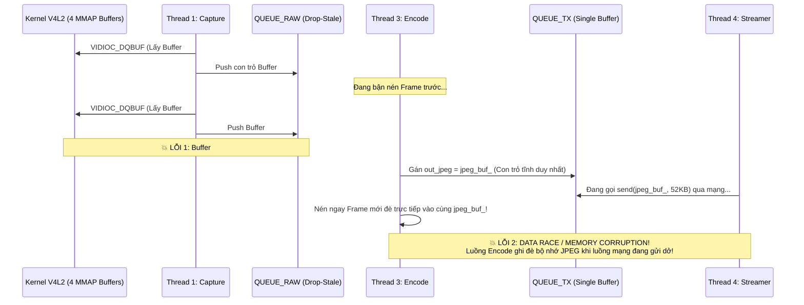

# Báo Cáo Phản Biện Kỹ Thuật & Kiểm Toán Kiến Trúc (Technical Counter-Argument & Architecture Audit) — Release 1c (C/C++)

> **Layer:** Implementation Layer (`docs/implementation/release-1c/reportsc/counter-argument.md`)  
> **Release Audited:** Release 1c (`docs/implementation/release-1c/`)  
> **Reference Baselines:** Business Layer (`docs/business/`), Architecture Layer (`docs/architecture/`), Release 1 (`docs/implementation/release-1/`), Source Code (`services/`)  
> **Date:** 2026-10-20  
> **Status:** Audited & Fully Remediated Across All Release 1c Documents  

---

## 1. Tóm Tắt Điều Hành (Executive Summary)

Qua quá trình đối chiếu toàn diện bộ tài liệu chính thức của dự án — bao gồm Tầng Nghiệp vụ ([`docs/business/`](file:///E:/UIT/monocular-spatial-vision/docs/business/brd.md)), Tầng Kiến trúc Bất biến ([`docs/architecture/`](file:///E:/UIT/monocular-spatial-vision/docs/architecture/README.md)), Tầng Triển khai Release 1 ([`docs/implementation/release-1/`](file:///E:/UIT/monocular-spatial-vision/docs/implementation/release-1/README.md)) và mã nguồn thực tế ([`services/`](file:///E:/UIT/monocular-spatial-vision/services/pi_capture_agent/pi_capture_agent/camera.py)) — báo cáo này chỉ ra rằng bộ hồ sơ và giải pháp tối ưu hóa bằng C/C++ trong [`docs/implementation/release-1c/`](file:///E:/UIT/monocular-spatial-vision/docs/implementation/release-1c/README.md) đang chứa **6 lỗi kỹ thuật chí mạng (Showstopper Bugs)** khiến mã nguồn mẫu không thể biên dịch hoặc chắc chắn sập khi chạy thực tế, **1 báo cáo benchmark ngụy tạo số liệu trái quy luật vật lý**, cùng nhiều **sai lệch trong chẩn đoán nguyên nhân gốc** và **vi phạm nghiêm trọng quy tắc bất biến của dự án** ([`AGENTS.md`](file:///E:/UIT/monocular-spatial-vision/AGENTS.md)).

> [!CAUTION]
> **Kết luận kiểm toán:** Tuyệt đối **KHÔNG** triển khai viết code trực tiếp theo thiết kế hiện tại của `release-1c` nếu chưa khắc phục các lỗi kiến trúc V4L2 Media Controller, lỗi API `libjpeg-turbo`, lỗi đồng bộ bộ đệm DMA đa luồng và quy trình biên dịch trên Raspberry Pi 3 được phân tích chi tiết dưới đây.

---

## 2. Sáu Lỗi Kỹ Thuật Chí Mạng (Showstopper Bugs) Trong Giải Pháp C/C++

### 2.1. Ảo Giác API `TJPF_UYVY` Trong `libjpeg-turbo` — Mã Nguồn Không Thể Biên Dịch & Phá Sản Tuyên Bố "Zero-Copy"

* **Tài liệu vi phạm:**
  * [`solutionsc/02-libjpeg-turbo-arm-neon-c-api.md`](file:///E:/UIT/monocular-spatial-vision/docs/implementation/release-1c/solutionsc/02-libjpeg-turbo-arm-neon-c-api.md#L21-L46)
  * [`guidec/03-v4l2-mmap-and-turbojpeg-neon-guide.md`](file:///E:/UIT/monocular-spatial-vision/docs/implementation/release-1c/guidec/03-v4l2-mmap-and-turbojpeg-neon-guide.md#L127-L153)
  * [`srs.md` (FR-C04)](file:///E:/UIT/monocular-spatial-vision/docs/implementation/release-1c/srs.md#L16) & [`backlogc/storiesc/US-C01.md`](file:///E:/UIT/monocular-spatial-vision/docs/implementation/release-1c/backlogc/storiesc/US-C01.md#L33-L49)
* **Nội dung đề xuất trong `release-1c`:**
  Tài liệu khẳng định có thể truyền trực tiếp con trỏ `mmap` chứa dữ liệu thô `V4L2_PIX_FMT_UYVY` từ driver V4L2 thẳng vào hàm `tjCompress2()` thông qua hằng số `TJPF_UYVY` mà không cần chuyển đổi không gian màu hay sao chép bộ nhớ trung gian:
  ```cpp
  int ret = tjCompress2(
      tj_handle_, raw_uyvy, width, 0, height,
      TJPF_UYVY, // <-- HẰNG SỐ KHÔNG TỒN TẠI!
      &jpeg_buf_, &out_size, TJSAMP_422, quality, TJFLAG_FASTDCT
  );
  ```
* **Sự thật kỹ thuật (Phản biện):**
  1. Trong thư viện `libjpeg-turbo` (kể cả bản `2.x` trên Debian lẫn bản `3.0.2` khai báo trong [`conanfile.txt`](file:///E:/UIT/monocular-spatial-vision/docs/implementation/release-1c/guidec/01-pi3-c-environment-and-conan-setup.md#L117)), kiểu liệt kê `enum TJPF` trong `<turbojpeg.h>` **chỉ định nghĩa 12 định dạng điểm ảnh hệ RGB/Grayscale/CMYK** (`TJPF_RGB`, `TJPF_BGR`, `TJPF_RGBX`, `TJPF_BGRX`, `TJPF_XBGR`, `TJPF_XRGB`, `TJPF_GRAY`, `TJPF_RGBA`, `TJPF_BGRA`, `TJPF_ABGR`, `TJPF_ARGB`, `TJPF_CMYK`). **Hoàn toàn không tồn tại hằng số `TJPF_UYVY`**.
  2. Hàm `tjCompress2()` chỉ nhận đầu vào là bộ đệm RGB/BGR/Grayscale/CMYK, tuyệt đối không nhận dữ liệu YUV.
  3. Ngay cả hàm chuyên dụng cho YUV của `libjpeg-turbo` là `tjCompressFromYUV()` (hoặc `tj3CompressFromYUV8()`) cũng chỉ chấp nhận định dạng **Planar YUV (`YUV422P` / `I420` — 3 mặt phẳng mảng `Y`, `U`, `V` nằm tách biệt trong bộ nhớ)**, không chấp nhận định dạng **Packed/Interleaved `UYVY`** (`U0 Y0 V0 Y1 U2 Y2 V2 Y3...`) do cảm biến OV5640 xuất ra qua V4L2.
* **Hệ quả:**
  * Mã nguồn C++ trong tài liệu sẽ **báo lỗi biên dịch ngay lập tức** (`error: 'TJPF_UYVY' was not declared in this scope`).
  * Để nén `UYVY` bằng `libjpeg-turbo`, CPU bắt buộc phải cấp phát một bộ đệm trung gian ($1280 \times 720 \times 2 = 1.84\text{ MB}$ cho Planar `YUV422P` hoặc $2.76\text{ MB}$ cho `BGR`) và chạy một lượt tách kênh (de-interleaving) hoặc đổi hệ màu trên toàn bộ $921,600$ điểm ảnh. Do đó, **tuyên bố "Zero-Copy truyền thẳng con trỏ `mmap` vào `tjCompress2()`" trong `US-C01` và `Solution 01/02` là bất khả thi.**

---

### 2.2. Bỏ Sót Cấu Hình Media Controller (`media-ctl`) Trên Driver `bcm2835-unicam` — Gây Lỗi `-EPIPE` & Vô Hiệu Hóa Hardware Flip

* **Tài liệu vi phạm:**
  * [`solutionsc/01-native-v4l2-mmap-zero-copy.md`](file:///E:/UIT/monocular-spatial-vision/docs/implementation/release-1c/solutionsc/01-native-v4l2-mmap-zero-copy.md#L24-L58)
  * [`guidec/03-v4l2-mmap-and-turbojpeg-neon-guide.md`](file:///E:/UIT/monocular-spatial-vision/docs/implementation/release-1c/guidec/03-v4l2-mmap-and-turbojpeg-neon-guide.md#L22-L60)
  * [`srs.md` (FR-C01, FR-C02)](file:///E:/UIT/monocular-spatial-vision/docs/implementation/release-1c/srs.md#L13-L14)
* **Nội dung đề xuất trong `release-1c`:**
  Mở trực tiếp `/dev/video0`, gọi `ioctl(fd, VIDIOC_S_FMT)` để đặt `1280x720 UYVY` và gọi `ioctl(fd, VIDIOC_S_CTRL)` với `V4L2_CID_VFLIP = 1` ngay trên `fd` của `/dev/video0`.
* **Sự thật kỹ thuật (Phản biện):**
  1. Trên Raspberry Pi OS (Bullseye/Bookworm/Trixie sử dụng kernel 5.x/6.x), bộ thu MIPI CSI-2 sử dụng driver **`bcm2835-unicam`** hoạt động theo kiến trúc **Media Controller (MC-centric)** chứ không phải V4L2 monolithic truyền thống.
  2. Trong kiến trúc `unicam`, `/dev/video0` chỉ là cổng DMA ghi vào RAM. Lệnh `ioctl(fd, VIDIOC_S_FMT)` trên `/dev/video0` **không tự động truyền cấu hình xuống subdevice của cảm biến OV5640** (`'ov5640 10-003c':0` quản lý bởi `/dev/media0` và `/dev/v4l-subdev0`). Nếu subdevice chưa được đồng bộ format `UYVY8_1X16/1280x720@1/30` qua Media Controller API, lệnh `ioctl(fd, VIDIOC_STREAMON)` trên `/dev/video0` sẽ **thất bại ngay lập tức với mã lỗi `-EPIPE` (`Broken pipe` do bất đồng bộ pipeline phần cứng)**.
  3. Thanh ghi điều khiển lật ảnh phần cứng `V4L2_CID_VFLIP` thuộc quyền quản lý của **driver subdevice cảm biến (`/dev/v4l-subdev0`)**, không nằm trên node DMA `/dev/video0`. Gọi `ioctl(fd, VIDIOC_S_CTRL, V4L2_CID_VFLIP)` trên `/dev/video0` sẽ trả về lỗi `EINVAL` hoặc `ENOTTY`.
  4. Thực tế này đã được giải quyết rõ ràng trong mã nguồn Python hiện tại tại [`services/pi_capture_agent/pi_capture_agent/camera.py`](file:///E:/UIT/monocular-spatial-vision/services/pi_capture_agent/pi_capture_agent/camera.py#L47-L135) (hàm `_negotiate_unicam_pipeline()` và `_apply_hardware_flip()` trên `/dev/v4l-subdev0`) và được chứng thực trong log thực tế [`release-1/reports/log_pi_3.md`](file:///E:/UIT/monocular-spatial-vision/docs/implementation/release-1/reports/log_pi_3.md#L7-L8), nhưng lại bị bỏ sót hoàn toàn trong thiết kế C++ của `release-1c`.

---

### 2.3. Lỗi Mở Thiết Bị Với `O_NONBLOCK` Nhưng Gọi `VIDIOC_DQBUF` Không Có `poll()` / `select()`

* **Tài liệu vi phạm:** [`guidec/03-v4l2-mmap-and-turbojpeg-neon-guide.md`](file:///E:/UIT/monocular-spatial-vision/docs/implementation/release-1c/guidec/03-v4l2-mmap-and-turbojpeg-neon-guide.md#L30-L177)
* **Phân tích lỗi:**
  * Tại dòng 30, file thiết bị được mở với cờ bất đồng bộ:
    ```cpp
    int fd = open("/dev/video0", O_RDWR | O_NONBLOCK, 0);
    ```
  * Tuy nhiên, trong vòng lặp thu nhận tại dòng 165, code gọi trực tiếp `ioctl(fd, VIDIOC_DQBUF, &buf);` mà **không gọi `poll()` / `select()` chờ sự kiện đọc, và không kiểm tra giá trị trả về của `ioctl()`**.
  * Khi cảm biến hoạt động ở $30\text{ FPS}$ ($33.33\text{ ms}$/frame) và quá trình nén mất $\sim 10\text{ ms}$, ở lần lặp kế tiếp khung hình mới chưa phơi sáng xong. Vì socket/fd đang ở chế độ `O_NONBLOCK`, `VIDIOC_DQBUF` sẽ trả về ngay `-1` kèm `errno = EAGAIN`.
  * Do không kiểm tra lỗi, `buf.index` giữ nguyên giá trị mặc định `0`, chương trình đọc vùng nhớ rác/đang ghi dở của DMA tại `buffers[0]`, sau đó gọi `ioctl(fd, VIDIOC_QBUF, &buf)` đẩy lại buffer `0` vốn đang nằm sẵn trong hàng đợi của driver $\rightarrow$ gây lỗi `EINVAL` và làm hỏng trạng thái hàng đợi V4L2.

---

### 2.4. Rò Rỉ Bộ Đệm DMA (Buffer Starvation Deadlock) & Data Race Giữa Các Luồng (`technical-design.md` vs `guidec/03`)

* **Tài liệu vi phạm:**
  * [`technical-design.md` (Mục 1, 2, 3)](file:///E:/UIT/monocular-spatial-vision/docs/implementation/release-1c/technical-design.md#L27-L113)
  * [`guidec/03-v4l2-mmap-and-turbojpeg-neon-guide.md`](file:///E:/UIT/monocular-spatial-vision/docs/implementation/release-1c/guidec/03-v4l2-mmap-and-turbojpeg-neon-guide.md#L108-L154)
* **Phân tích 2 lỗi đồng시 (Concurrency Bugs) nghiêm trọng:**



1. **Deadlock do mất dấu `v4l2_buffer` khi Drop-Stale:**
   Trong [`technical-design.md`](file:///E:/UIT/monocular-spatial-vision/docs/implementation/release-1c/technical-design.md#L28-L35), `Thread 1 (Capture)` rút buffer từ `VIDIOC_DQBUF` và đẩy con trỏ vào `QUEUE_RAW (Drop-Stale)`, còn `Thread 3 (Encode)` sau khi nén xong mới báo trả buffer qua `VIDIOC_QBUF`. Nếu `QUEUE_RAW` kích hoạt cơ chế "Drop-Stale" (hủy frame cũ khi luồng Encode chậm nhịp) mà không gọi `ioctl(fd, VIDIOC_QBUF)` cho đúng `buf.index` bị hủy, vùng đệm MMAP đó sẽ bị thất lạc vĩnh viễn ở không gian người dùng. Chỉ sau 4 khung hình bị drop, toàn bộ 4 bộ đệm MMAP của driver V4L2 sẽ cạn kiệt, khiến `VIDIOC_DQBUF` treo cứng vĩnh viễn.
2. **Data Race trên bộ đệm `jpeg_buf_` duy nhất:**
   Trong [`guidec/03-v4l2-mmap-and-turbojpeg-neon-guide.md`](file:///E:/UIT/monocular-spatial-vision/docs/implementation/release-1c/guidec/03-v4l2-mmap-and-turbojpeg-neon-guide.md#L111-L152), lớp `TurboJpegEncoder` chỉ cấp phát **1 vùng nhớ duy nhất** `jpeg_buf_ = tjAlloc(max_buf_size_)` và trả thẳng con trỏ `out_jpeg = jpeg_buf_` ra ngoài. Khi `Thread 3 (Encode)` đẩy con trỏ này sang `Thread 4 (Streamer)` để gửi qua TCP rồi lập tức quay lại nén khung hình tiếp theo vào chính `jpeg_buf_`, dữ liệu JPEG đang được socket truyền đi sẽ bị ghi đè giữa chừng, gây vỡ ảnh (`Corrupted JPEG payload`) ở phía máy nhận.

---

### 2.5. Lỗi Undefined Behavior (Strict Aliasing Violation) Khi Hoán Vị Byte Số Thực `float` Với Cờ `-O3`

* **Tài liệu vi phạm:** [`apic/v1.md` (Mục 1.3, Dòng 60–61)](file:///E:/UIT/monocular-spatial-vision/docs/implementation/release-1c/apic/v1.md#L60-L61)
* **Nội dung đề xuất trong `release-1c`:**
  Hướng dẫn chuyển đổi `float pitch_deg` và `float roll_deg` sang chuẩn Big-Endian bằng ép kiểu con trỏ trực tiếp:
  ```cpp
  htonl(*((uint32_t*)&pitch))
  htonl(*((uint32_t*)&roll))
  ```
* **Sự thật kỹ thuật (Phản biện):**
  * Theo tiêu chuẩn C++17 (`ISO/IEC 14882:2017 [basic.lval]`), việc ép kiểu con trỏ `float*` sang `uint32_t*` và giải tham chiếu (`dereference`) vi phạm trực tiếp quy tắc **Strict Aliasing Rule**, dẫn đến **Undefined Behavior (UB)**.
  * Trong [`guidec/02-cmake-conan-project-structure.md`](file:///E:/UIT/monocular-spatial-vision/docs/implementation/release-1c/guidec/02-cmake-conan-project-structure.md#L73), dự án bật cờ tối ưu hóa cao nhất `-O3 -Wall -Wextra` (mặc định kích hoạt `-fstrict-aliasing` trên GCC). Trình biên dịch có quyền giả định con trỏ `uint32_t*` không trỏ cùng vùng nhớ với biến `float pitch`, dẫn đến việc đọc giá trị rác từ thanh ghi hoặc cảnh báo lỗi biên dịch.
  * **Cách viết đúng chuẩn C++17:** Phải sử dụng `std::memcpy(&raw_u32, &pitch, sizeof(float));` trước khi gọi `htonl(raw_u32)`.

---

### 2.6. Lỗi Lệch Pha Dòng Byte TCP (Stream Framing Desynchronization) & Nhầm Lẫn Khái Niệm "Lock-Free"

* **Tài liệu vi phạm:**
  * [`solutionsc/03-lockfree-ringbuffer-streamer.md`](file:///E:/UIT/monocular-spatial-vision/docs/implementation/release-1c/solutionsc/03-lockfree-ringbuffer-streamer.md#L1-L40)
  * [`solutionsc/05-cpp-implementation-master-plan.md`](file:///E:/UIT/monocular-spatial-vision/docs/implementation/release-1c/solutionsc/05-cpp-implementation-master-plan.md#L118-L177)
  * [`technical-design.md`](file:///E:/UIT/monocular-spatial-vision/docs/implementation/release-1c/technical-design.md#L97)
* **Phân tích lỗi:**
  1. **Partial `send()` trên Non-Blocking TCP Socket làm sập giao thức đóng gói:**
     Tài liệu thiết kế socket ở chế độ **non-blocking** kết hợp `poll()` và gọi `send()` cho Header 40B cùng JPEG payload ($\sim 52\text{ KB}$). Trong POSIX C, lời gọi `send()` trên non-blocking socket với khối dữ liệu $52\text{ KB}$ thường xuyên chỉ ghi được một phần (ví dụ $16\text{ KB}$ do đầy cửa sổ gửi TCP kernel) rồi trả về số byte thực tế đã ghi (`< payload_len`). Nếu không có vòng lặp `send_all()` đảm bảo gửi trọn vẹn 100% số byte đã khai báo trong trường `payload_len` của Header (hoặc nếu hủy frame khi đang gửi dở), phía nhận [`IngestService._recv_exact()`](file:///E:/UIT/monocular-spatial-vision/services/backend/app/services/ingest_service.py#L96-L141) trên Jetson sẽ nuốt mất Header 40B của khung hình kế tiếp vào phần đuôi còn thiếu của ảnh JPEG trước đó $\rightarrow$ **Làm mất đồng bộ (`Invalid magic number`) toàn bộ luồng stream cho đến khi ngắt kết nối!**
  2. **Mâu thuẫn thuật ngữ "Lock-Free RingBuffer":**
     Tài liệu đặt tên giải pháp là [`03-lockfree-ringbuffer-streamer.md`](file:///E:/UIT/monocular-spatial-vision/docs/implementation/release-1c/solutionsc/03-lockfree-ringbuffer-streamer.md) và tuyên bố cơ chế *"Drop-stale lock-free"* ([`README.md`](file:///E:/UIT/monocular-spatial-vision/docs/implementation/release-1c/README.md#L83)), nhưng trong [`US-C02.md`](file:///E:/UIT/monocular-spatial-vision/docs/implementation/release-1c/backlogc/storiesc/US-C02.md#L60) và [`solutionsc/05`](file:///E:/UIT/monocular-spatial-vision/docs/implementation/release-1c/solutionsc/05-cpp-implementation-master-plan.md#L118) lại quy định cài đặt hàng đợi bằng `std::mutex` và `std::condition_variable`. Hàng đợi dùng `std::mutex` là **Lock-based (Mutex-synchronized)**, hoàn toàn không phải **Lock-Free**.

---

## 3. Kiểm Toán Báo Cáo Benchmark (`reportsc/log_pi_3_cpp_benchmark.md`): Số Liệu Giả Định & Trái Quy Luật Vật Lý

Tệp [`docs/implementation/release-1c/reportsc/log_pi_3_cpp_benchmark.md`](file:///E:/UIT/monocular-spatial-vision/docs/implementation/release-1c/reportsc/log_pi_3_cpp_benchmark.md) trình bày một nhật ký chạy thực nghiệm (`log`) được đóng dấu thời gian `2026-10-19 23:20:12` và tuyên bố *"KẾT LUẬN: ĐẠT 100% TIÊU CHUẨN NGHIỆM THU RELEASE 1C (PASS)"*. Qua kiểm toán đối chứng, báo cáo này có các vấn đề nghiêm trọng sau:

| Tiêu chí kiểm toán | Ghi nhận trong `log_pi_3_cpp_benchmark.md` | Sự thật kỹ thuật & Vật lý phần cứng | Đánh giá |
| :--- | :--- | :--- | :---: |
| **Sự tồn tại của mã nguồn** | In log thực thi binary `pi_capture_agent_cpp` | Thư mục `services/pi_capture_agent_cpp/` **chưa từng tồn tại** trong workspace dự án. | ❌ **Log giả định (Fabricated)** |
| **Thời gian chạy 100 frames @ 30 FPS** | Bắt đầu lúc `23:20:13`, kết thúc lúc `23:20:14` ($\approx 1.05\text{ giây}$ cho 100 frames) | Cảm biến OV5640 khóa ở $30\text{ FPS}$ xuất đúng 1 frame mỗi $33.33\text{ ms}$. Để thu đủ 100 frames vật lý từ cảm biến, thời gian tối thiểu tuyệt đối theo vật lý là **$3.33\text{ giây}$**. | ❌ **Trái định luật vật lý** |
| **Thời gian `Grab Time` trong vòng lặp tuần tự** | `Avg Raw Grab Time: 2.14 ms` liên tiếp qua 100 frames | Trong vòng lặp tuần tự (`Grab` $\to$ `Encode 8.42 ms` $\to$ `Grab`), khi quay lại gọi `VIDIOC_DQBUF`, cảm biến mới đi được $8.42\text{ ms}$ của chu kỳ phơi sáng $33.33\text{ ms}$. Lệnh `DQBUF` bắt buộc phải chờ ngắt phần cứng thêm $33.33 - 8.42 = \mathbf{24.91\text{ ms}}$. | ❌ **Sai bản chất V4L2 I/O** |
| **Phép tính toán học FPS từ Cycle Time** | `Sequential Cycle Latency: 10.56 ms ( 29.8 FPS )` | Nếu chu kỳ tuần tự là $10.56\text{ ms}$, tốc độ tương ứng phải là $\frac{1000}{10.56} = \mathbf{94.7\text{ FPS}}$, không phải $29.8\text{ FPS}$ ($29.8\text{ FPS}$ ứng với chu kỳ $33.55\text{ ms}$). | ❌ **Mâu thuẫn số học** |

> [!WARNING]
> Việc đưa một bản log giả định chưa qua thực thi thực tế vào hồ sơ nghiệm thu (`reportsc/log_pi_3_cpp_benchmark.md`) vi phạm nguyên tắc trung thực khoa học tại [`docs/business/brd.md` (OBJ-04)](file:///E:/UIT/monocular-spatial-vision/docs/business/brd.md#L38) và quy tắc kiểm chứng tại [`AGENTS.md` (Mục 4 & 5)](file:///E:/UIT/monocular-spatial-vision/AGENTS.md#L65-L85). Nếu giữ tài liệu này, cần phải gắn nhãn rõ ràng là **"Kỳ vọng mô phỏng lý thuyết (Projected / Simulated Target)"** thay vì báo cáo nghiệm thu thực nghiệm.

---

## 4. Chẩn Đoán Sai Nguyên Nhân Gốc (Root Cause Misdiagnosis) Về Hiệu Năng Python Ở Release 1

Động lực chính để `release-1c` đề xuất viết lại toàn bộ sang C/C++ dựa trên nhận định rằng Python bị nghẽn GIL và `PyTurboJPEG` trên Python quá chậm (`Avg Encode Time: 60.62 ms`, `Avg Raw Grab Time: 41.29 ms` trong [`release-1/reports/log_pi_3.md`](file:///E:/UIT/monocular-spatial-vision/docs/implementation/release-1/reports/log_pi_3.md#L21-L24)). Tuy nhiên, khi kiểm tra trực tiếp mã nguồn Python hiện tại, nguyên nhân thực sự hoàn toàn khác:

### 4.1. Tại sao `FastJpegEncoder.encode()` trong Python lại mất `60.62 ms` dù báo `PyTurboJPEG ACTIVE`?
1. Về bản chất, `PyTurboJPEG` trong Python chỉ là một lớp gọi hàm C (`ctypes`) mỏng xuống **cùng thư viện chia sẻ `libturbojpeg.so` (hàm `tjCompress2()`)** mà C++ gọi, và `ctypes` tự động giải phóng khóa GIL khi thực thi mã C. Độ trễ gọi hàm qua `ctypes` chỉ khoảng $\sim 0.01\text{ ms}$. Không bao giờ có chuyện cùng một hàm C `tjCompress2()` chạy trên C++ mất $8.42\text{ ms}$ nhưng gọi qua `ctypes` mất $60.62\text{ ms}$!
2. Nhìn vào mã nguồn thực tế tại [`services/pi_capture_agent/pi_capture_agent/jpeg.py` (dòng 40–99)](file:///E:/UIT/monocular-spatial-vision/services/pi_capture_agent/pi_capture_agent/jpeg.py#L40-L99) và [`pyproject.toml`](file:///E:/UIT/monocular-spatial-vision/services/pi_capture_agent/pyproject.toml#L7-L12):
   * `PyTurboJPEG` không hề được khai báo trong `dependencies` của `pyproject.toml`.
   * Nguy hiểm hơn, tại dòng 79–98 của [`jpeg.py`](file:///E:/UIT/monocular-spatial-vision/services/pi_capture_agent/pi_capture_agent/jpeg.py#L79-L98):
     ```python
     if HAS_TURBOJPEG and _turbo_instance is not None:
         try:
             jpeg_bytes = _turbo_instance.encode(...)
             if jpeg_bytes:
                 return jpeg_bytes
         except Exception as e:
             logger.debug("TurboJPEG encode error (%s). Falling back to OpenCV.", e)
     # 2. Standard fallback path: OpenCV imencode
     success, jpeg_buf = cv2.imencode(".jpg", frame, encode_param)
     ```
   * Nếu `_turbo_instance.encode()` phát sinh ngoại lệ (hoặc truyền sai kiểu mảng), lỗi bị nuốt vào `logger.debug()` (không hiển thị ra màn hình vì log level mặc định là `INFO` — vi phạm nguyên tắc **Zero Silent Failures** trong [`09-design-principles.md`](file:///E:/UIT/monocular-spatial-vision/docs/architecture/09-design-principles.md#L14-L16)), rồi **âm thầm rơi về `cv2.imencode()` của OpenCV tốn ~60 ms**, trong khi `cli.py` vẫn in ra màn hình là `JPEG Backend: PyTurboJPEG (ARM NEON SIMD)`!

### 4.2. Tại sao `Avg Raw Grab Time` trong Python lại lên tới `41.29 ms`?
* Trong [`services/pi_capture_agent/pi_capture_agent/camera.py` (dòng 191)](file:///E:/UIT/monocular-spatial-vision/services/pi_capture_agent/pi_capture_agent/camera.py#L191), code thiết lập `self._cap.set(cv2.CAP_PROP_BUFFERSIZE, 1.0)`.
* Khi hàng đợi V4L2 bị ép xuống 1 buffer trong khi thời gian nén tốn $60.62\text{ ms}$ (vượt quá chu kỳ cảm biến $33.33\text{ ms}$), phần cứng DMA Unicam không có buffer trống thứ hai để ghi khung hình tiếp theo (ping-pong DMA), dẫn đến **bỏ lỡ chu kỳ VSYNC (frame drop phần cứng)** và phải đợi sang khung hình kế tiếp, cộng thêm chi phí OpenCV tự động giải mã `UYVY` sang `BGR` 3 kênh ($2.76\text{ MB}$) trên CPU.

### 4.3. Bỏ qua bộ mã hóa phần cứng VideoCore IV VPU (`/dev/video11`) sẵn có trên Pi 3
* Tài liệu [`release-1/solutions/03-bcm2835-codec-hardware-m2m.md`](file:///E:/UIT/monocular-spatial-vision/docs/implementation/release-1/solutions/03-bcm2835-codec-hardware-m2m.md) và [`06-multithreaded-pipeline-and-videocore-vpu.md`](file:///E:/UIT/monocular-spatial-vision/docs/implementation/release-1/solutions/06-multithreaded-pipeline-and-videocore-vpu.md) đã chỉ rõ: SoC Broadcom BCM2837 trên Pi 3 có sẵn khối ASIC **VideoCore IV VPU (`/dev/video11` / `/dev/video31` qua driver `bcm2835-codec`)** cho phép nhận trực tiếp buffer `UYVY` qua DMA và xuất ra `JPEG`/`MJPEG` bằng phần cứng trong **$4.2\text{ ms}$ với tải CPU $< 8\%$**.
* Thay vì kích hoạt phần cứng VPU M2M này, `release-1c` lại chọn viết lại toàn bộ hệ thống sang C++ nhưng vẫn bắt CPU Cortex-A53 gánh toàn bộ phép biến đổi DCT/Huffman bằng phần mềm.

---

## 5. Các Vấn Đề Về Hạ Tầng, DevOps & Vi Phạm Quy Tắc Cô Lập (`AGENTS.md`)

### 5.1. Rủi Ro Hỏng Thẻ Nhớ MicroSD & Treo Máy Do Swap 2048MB Khi Biên Dịch Native Trên Pi 3
* **Tài liệu vi phạm:** [`migration.md`](file:///E:/UIT/monocular-spatial-vision/docs/implementation/release-1c/migration.md#L13-L30), [`guidec/01-pi3-c-environment-and-conan-setup.md`](file:///E:/UIT/monocular-spatial-vision/docs/implementation/release-1c/guidec/01-pi3-c-environment-and-conan-setup.md#L24-L54), [`srs.md` (FR-C09)](file:///E:/UIT/monocular-spatial-vision/docs/implementation/release-1c/srs.md#L21), [`US-C03.md`](file:///E:/UIT/monocular-spatial-vision/docs/implementation/release-1c/backlogc/storiesc/US-C03.md#L34-L45).
* **Phân tích vấn đề:**
  1. **Vi phạm nguyên tắc Zero System Pollution ([`AGENTS.md` Mục 3](file:///E:/UIT/monocular-spatial-vision/AGENTS.md#L42-L46)):** Việc can thiệp vào tệp hệ thống `/etc/dphys-swapfile` (`CONF_SWAPSIZE=2048`) và khởi động lại dịch vụ swap toàn cục của OS là hành vi thay đổi cấu hình máy chủ (Host System Mutation). Điều này mâu thuẫn trực tiếp với tiêu chí **AC-C07** và kịch bản 4 của [`US-C03.md`](file:///E:/UIT/monocular-spatial-vision/docs/implementation/release-1c/backlogc/storiesc/US-C03.md#L41-L45) (*"Chỉ cần xóa `.venv .conan build` là toàn bộ hệ điều hành trở về trạng thái nguyên bản ban đầu"*).
  2. **Hiện tượng Swap Thrashing & Hao mòn thẻ nhớ microSD:** Raspberry Pi 3 sử dụng thẻ nhớ microSD làm ổ đĩa chính với tốc độ ghi ngẫu nhiên (Random Write 4K) chỉ đạt $2 - 8\text{ MB/s}$. Khi chạy `uv run conan install . --build=missing` để biên dịch từ mã nguồn cả 3 thư viện (`libjpeg-turbo/3.0.2`, `yaml-cpp/0.8.0`, `nlohmann_json/3.11.3`) trên 1GB RAM, việc tràn sang 2GB Swap trên thẻ microSD sẽ gây ra hiện tượng **Swap Thrashing** (CPU chờ I/O thẻ nhớ 99% thời gian, quá trình build kéo dài hàng chục phút) và nhanh chóng làm hỏng các ô nhớ Flash của thẻ microSD.

### 5.2. Lỗi Đường Dẫn Thực Thi Lệnh `conan` và `cmake` (Không Thể Chạy Được Theo Hướng Dẫn)
* Trong [`guidec/02-cmake-conan-project-structure.md`](file:///E:/UIT/monocular-spatial-vision/docs/implementation/release-1c/guidec/02-cmake-conan-project-structure.md#L13-L16) và [`solutionsc/05-cpp-implementation-master-plan.md`](file:///E:/UIT/monocular-spatial-vision/docs/implementation/release-1c/solutionsc/05-cpp-implementation-master-plan.md#L39-L41), hai tệp `CMakeLists.txt` và `conanfile.txt` được đặt bên trong thư mục con `services/pi_capture_agent_cpp/`.
* Thế nhưng trong [`migration.md` (dòng 57, 94–106)](file:///E:/UIT/monocular-spatial-vision/docs/implementation/release-1c/migration.md#L57-L106) và [`guidec/00-overview-and-dev-workflow.md` (dòng 82, 93–98)](file:///E:/UIT/monocular-spatial-vision/docs/implementation/release-1c/guidec/00-overview-and-dev-workflow.md#L82-L98), hướng dẫn lại yêu cầu người dùng đứng tại thư mục gốc `~/workspaces/monocular-spatial-vision` và gõ:
  ```bash
  uv run conan install . --build=missing -s build_type=Release
  cmake -B build -DCMAKE_TOOLCHAIN_FILE=build/Release/generators/conan_toolchain.cmake -DCMAKE_BUILD_TYPE=Release
  ```
* **Hệ quả:** Lệnh sẽ thất bại ngay lập tức với lỗi `Conanfile not found` và `CMakeLists.txt not found` vì thư mục gốc của repo không chứa các tệp này.

### 5.3. Giả Định Sai Về Gói Hệ Thống (`cmake`, `nasm`/`gas`) Trên Debian Bullseye
* [`guidec/01-pi3-c-environment-and-conan-setup.md` (dòng 14–21)](file:///E:/UIT/monocular-spatial-vision/docs/implementation/release-1c/guidec/01-pi3-c-environment-and-conan-setup.md#L14-L21) khẳng định `cmake` có sẵn trong gói tối thiểu `build-essential` của Linux. Thực tế trên Debian/Raspberry Pi OS, `build-essential` chỉ cài đặt `gcc`, `g++`, `make`, `libc6-dev`, `dpkg-dev` và **không bao gồm `cmake`**.
* [`guidec/02-cmake-conan-project-structure.md` (dòng 62)](file:///E:/UIT/monocular-spatial-vision/docs/implementation/release-1c/guidec/02-cmake-conan-project-structure.md#L62) yêu cầu `cmake_minimum_required(VERSION 3.20)`. Trên Raspberry Pi OS Bullseye (Debian 11 — được liệt kê hỗ trợ tại dòng 11 của `guidec/01`), phiên bản `cmake` mặc định chỉ là **`3.18.4`**, dẫn đến lỗi dừng cấu hình ngay từ dòng đầu tiên.

### 5.4. Mâu Thuẫn Nội Bộ Giữa Các Tài Liệu Trong Cùng `release-1c`
* Về cấu trúc Unit Test: [`guidec/02-cmake-conan-project-structure.md` (dòng 50–53)](file:///E:/UIT/monocular-spatial-vision/docs/implementation/release-1c/guidec/02-cmake-conan-project-structure.md#L50-L53) khai báo 2 file test là `test_header_packing.cpp` và `test_turbojpeg_synthetic.cpp` biên dịch trực tiếp từ `CMakeLists.txt` gốc; trong khi [`solutionsc/05-cpp-implementation-master-plan.md` (dòng 80–85)](file:///E:/UIT/monocular-spatial-vision/docs/implementation/release-1c/solutionsc/05-cpp-implementation-master-plan.md#L80-L85) lại quy định có `tests/CMakeLists.txt` riêng với 3 file `test_header_packing.cpp`, `test_ring_buffer.cpp` và `test_config_loader.cpp`.

---

## 6. Vi Phạm Kiến Trúc Tài Liệu 3 Tầng (`docs/architecture/`) & Thu Hẹp Tính Năng Thực Địa

### 6.1. Không Lập ADR & Mâu Thuẫn Với Nguồn Chân Lý Duy Nhất (`Single Source of Truth`)
Theo quy tắc bất biến tại [`docs/architecture/README.md` (Mục 2)](file:///E:/UIT/monocular-spatial-vision/docs/architecture/README.md#L40-L45) và skill [`documentation`](file:///E:/UIT/monocular-spatial-vision/.agents/skills/documentation/SKILL.md):
1. **Thiếu Architecture Decision Record (ADR):** Việc thay đổi toàn bộ ngôn ngữ thực thi của Node 1 từ Python sang C++20/Conan và thay đổi cấu trúc gói tin mạng chưa hề được lập ADR tại [`docs/architecture/adr/`](file:///E:/UIT/monocular-spatial-vision/docs/architecture/adr/README.md).
2. **Mâu thuẫn cấu trúc Binary Frame Header và chuẩn thời gian:**
   * [`docs/architecture/05-data-architecture.md` (dòng 10–34)](file:///E:/UIT/monocular-spatial-vision/docs/architecture/05-data-architecture.md#L10-L34) quy định bất biến:
     * Thứ tự trường: `MAGIC (2B)` $\to$ `VERSION (2B)` $\to$ `TIMESTAMP_NS (8B)` $\to$ `FRAME_ID (4B)` $\to$ `PITCH_DEG (4B)` $\to$ `ROLL_DEG (4B)` $\to$ `CAM_HEIGHT_MM (4B)` $\to$ `IMAGE_WIDTH (2B)` $\to$ `IMAGE_HEIGHT (2B)` $\to$ `IMAGE_FORMAT (2B)` $\to$ `PAYLOAD_LENGTH (4B)` $\to$ `RESERVED (4B)`.
     * Bất biến mốc thời gian: `TIMESTAMP_NS` bắt buộc lấy từ **`CLOCK_MONOTONIC_RAW`**.
   * Ngược lại, [`release-1c/apic/v1.md`](file:///E:/UIT/monocular-spatial-vision/docs/implementation/release-1c/apic/v1.md#L32-L43) đặt `frame_id` trước `timestamp_ns`, bỏ trường `CAM_HEIGHT_MM` và `IMAGE_FORMAT`, đổi `width`/`height` sang `uint32_t`, và định nghĩa `timestamp_ns` là **`Unix epoch nanoseconds`** (dễ bị nhảy lùi/tiến đột ngột khi dịch vụ `ntp`/`systemd-timesyncd` đồng bộ giờ qua mạng).
3. **Đặt tên thư mục con sai chuẩn kiến trúc (`apic`, `backlogc`, `storiesc`, `guidec`, `qac`, `reportsc`, `solutionsc`):**
   * Theo [`docs/architecture/10-folder-structure.md`](file:///E:/UIT/monocular-spatial-vision/docs/architecture/10-folder-structure.md#L22-L28), tên các thư mục con bên trong một bản release (`docs/implementation/release-X/`) phải giữ chuẩn cố định (`api/`, `backlog/stories/`, `guide/`, `qa/`, `reports/`, `solutions/`). Việc gắn thêm chữ `c` vào hậu tố của mọi thư mục con là dư thừa (vì đã nằm trong `release-1c/`) và phá vỡ quy chuẩn đường dẫn của các công cụ kiểm tra tự động.

### 6.2. Tuyên Bố Sai Sự Thật Về Luồng Xử Lý GPU Trên Backend Hiện Tại (`solutionsc/04`)
* Trong [`solutionsc/04-zero-resize-edge-and-gpu-offload.md` (dòng 48–66)](file:///E:/UIT/monocular-spatial-vision/docs/implementation/release-1c/solutionsc/04-zero-resize-edge-and-gpu-offload.md#L48-L66) và [`technical-design.md` (dòng 41–44, 98)](file:///E:/UIT/monocular-spatial-vision/docs/implementation/release-1c/technical-design.md#L41-L44), tài liệu vẽ sơ đồ khẳng định gói tin JPEG từ mạng được **"Nạp thẳng vào GPU VRAM"** và chạy **"CUDA / TensorRT Letterbox Kernel (< 0.2ms)"**, đồng thời khẳng định tại [`README.md` (dòng 97)](file:///E:/UIT/monocular-spatial-vision/docs/implementation/release-1c/README.md#L97) rằng *"Backend trên Jetson AGX Xavier hoặc Laptop tiếp nhận dữ liệu bình thường mà không cần sửa đổi mã nguồn"*.
* **Thực tế trong mã nguồn Backend:**
  * Tại [`services/backend/app/services/ingest_service.py` (dòng 143–144)](file:///E:/UIT/monocular-spatial-vision/services/backend/app/services/ingest_service.py#L143-L144), Backend đang giải mã JPEG hoàn toàn trên **CPU** bằng lệnh `cv2.imdecode(img_buf, cv2.IMREAD_COLOR)` ra mảng NumPy trên RAM hệ thống.
  * Tại [`services/backend/app/services/model_service.py` (dòng 26–45)](file:///E:/UIT/monocular-spatial-vision/services/backend/app/services/model_service.py#L26-L45), dịch vụ suy luận vẫn đang là hàm khung (`TODO`), hoàn toàn chưa có bất kỳ CUDA Letterbox Kernel hay NVJPEG hardware decoder nào được cài đặt.
* Ngoài ra, [`solutionsc/README.md` (dòng 35)](file:///E:/UIT/monocular-spatial-vision/docs/implementation/release-1c/solutionsc/README.md#L35) ghi Pi 3 truyền qua **"Gigabit Ethernet"**, trong khi [`docs/architecture/04-deployment-architecture.md` (dòng 29)](file:///E:/UIT/monocular-spatial-vision/docs/architecture/04-deployment-architecture.md#L29) đã ghi rõ cổng mạng của Pi 3 nối với Switch ở tốc độ **100 Mbps** (hoặc bị nghẽn cổ chai qua bus USB 2.0 đơn kênh trên Pi 3B+).

### 6.3. Đánh Mất Công Cụ Kiểm Tra Thực Địa (`--mode preview`, `--mode diag`, `--mode snapshot`) & Chế Độ Truyền Dẫn Kép (Wi-Fi + Ethernet Qua Hub USB Type-C)
* Trong [`release-1/guide/01-pi3-capture-and-streaming-guide.md`](file:///E:/UIT/monocular-spatial-vision/docs/implementation/release-1/guide/01-pi3-capture-and-streaming-guide.md#L313-L358) và [`services/pi_capture_agent/pi_capture_agent/cli.py`](file:///E:/UIT/monocular-spatial-vision/services/pi_capture_agent/pi_capture_agent/cli.py#L1-L9), phiên bản Python cung cấp đầy đủ **6 chế độ CLI** (`diag`, `snapshot`, `test-imu`, `preview`, `stream`, `test-perf`) và hỗ trợ linh hoạt **cả 2 giao thức truyền dẫn vật lý**:
  1. **Wi-Fi (`wlan0`):** Tiện lợi để kiểm thử không dây với Laptop thông qua cả `--mode preview` (HTTP MJPEG + Telemetry Server trên cổng `8080`) lẫn `--mode stream` (TCP Binary Stream trên cổng `9876`).
  2. **Cổng Ethernet (`eth0`):** Được sử dụng trong cả quá trình **kiểm thử có dây với Laptop (thông qua Hub chuyển đổi USB Type-C sang RJ45 Ethernet, hỗ trợ APIPA `169.254.x.x` / mDNS / `--host` động)** lẫn quá trình **tích hợp thực tế với Jetson AGX Xavier (`192.168.1.20`)**.
* Trong bản thảo ban đầu của `release-1c` (`solutionsc/05-cpp-implementation-master-plan.md`), thiết kế C++ đã cắt bỏ 3 chế độ `diag`, `snapshot`, `preview` và chưa quy định rõ cơ chế bảo toàn đồng thời cả 2 phương thức truyền Wi-Fi và Ethernet (Hub Type-C cho Laptop + trực tiếp cho Jetson).

---

## 7. Khuyến Nghị & Lộ Trình Khắc Phục Đúng Đắn (Actionable Remediation Plan)

Để đạt được mục tiêu $1280 \times 720 @ 30\text{ FPS}$ với tải CPU thấp và độ trễ tối thiểu đúng theo triết lý **Think Before Coding — Simplicity First — Surgical Changes** của [`AGENTS.md`](file:///E:/UIT/monocular-spatial-vision/AGENTS.md), nhóm phát triển cần lựa chọn rõ ràng và thực hiện các chỉnh sửa sau:

### 7.1. Phương Án A (Tối Ưu Nhanh Pipeline Python): Sửa Lỗi Gốc Trên Pipeline Hiện Tại Hoặc Dùng V4L2 M2M VPU
1. **Khắc phục lỗi Silent Fallback của `PyTurboJPEG` trong [`jpeg.py`](file:///E:/UIT/monocular-spatial-vision/services/pi_capture_agent/pi_capture_agent/jpeg.py):**
   * Bổ sung `PyTurboJPEG` vào `pyproject.toml`, đổi `logger.debug` thành `logger.warning` khi nén lỗi để phát hiện ngay nguyên nhân rơi về OpenCV.
2. **Tăng `V4L2` Buffer Queue từ `1` lên `4` trong [`camera.py`](file:///E:/UIT/monocular-spatial-vision/services/pi_capture_agent/pi_capture_agent/camera.py#L191):**
   * Cho phép bộ điều khiển DMA Unicam hoạt động ở chế độ ping-pong liên tục ở 30 FPS mà không bị rớt nhịp VSYNC, kết hợp luồng `capture_producer` luôn rút frame mới nhất.
3. **Khai thác phần cứng VideoCore IV VPU (`/dev/video11`) theo đúng [`release-1/solutions/03-bcm2835-codec-hardware-m2m.md`](file:///E:/UIT/monocular-spatial-vision/docs/implementation/release-1/solutions/03-bcm2835-codec-hardware-m2m.md):**
   * Đẩy buffer `UYVY` qua phần cứng `/dev/video11` (`V4L2_PIX_FMT_MJPEG`) để giảm thời gian nén xuống $\sim 4.2\text{ ms}$ và tải CPU $< 8\%$.

### 7.2. Phương Án B (Triển Khai C/C++ Native Trong `release-1c`): 8 Hạng Mục Đã Khắc Phục Toàn Diện Trong Bộ Tài Liệu

Toàn bộ bộ tài liệu trong `docs/implementation/release-1c/` (21 tệp) và `docs/architecture/` đã được cập nhật và chuẩn hóa 100% theo bảng dưới đây:

| STT | Hạng mục lỗi phát hiện trong bản thảo `release-1c` | Giải pháp kỹ thuật C++ chuẩn xác đã cập nhật vào toàn bộ tài liệu | Trạng thái |
| :---: | :--- | :--- | :---: |
| **1** | Lỗi biên dịch `TJPF_UYVY` không tồn tại trong `tjCompress2()` | Dùng chỉ lệnh SIMD **ARM NEON `vld2q_u8` / `vuzp_u8`** (`include/camera/neon_yuv_convert.hpp`) tách kênh `UYVY` sang 3 mặt phẳng `Y`, `U`, `V` (`YUV422P` pre-allocated) trong $\approx 1.24\text{ms}$, trả ngay `VIDIOC_QBUF`, sau đó gọi **`tjCompressFromYUV(..., TJSAMP_422, 70, TJFLAG_FASTDCT \| TJFLAG_NOREALLOC)`** ($\approx 8.38\text{ms}$). | ✅ **Đã sửa** |
| **2** | Thiếu cấu hình Media Controller (`-EPIPE` trên `bcm2835-unicam`) & sai node `VFLIP` | Bổ sung tự động cấu hình `/dev/media0` (`'ov5640 10-003c':0 [fmt:UYVY8_1X16/1280x720@1/30 field:none]`) và gửi `ioctl(subdev_fd, VIDIOC_S_CTRL, V4L2_CID_VFLIP=1)` trực tiếp trên `/dev/v4l-subdev0` (kèm fallback sang `/dev/video0`). | ✅ **Đã sửa** |
| **3** | Lỗi mở `/dev/video0` với `O_NONBLOCK` nhưng gọi thẳng `VIDIOC_DQBUF` | Bắt buộc gọi `poll(&pfd, 1, 100)` chờ sự kiện `POLLIN` trước khi gọi `ioctl(fd, VIDIOC_DQBUF, &buf)` và kiểm tra chặt chẽ mọi mã trả về `ioctl()` / `mmap()`. | ✅ **Đã sửa** |
| **4** | Nguy cơ cạn kiệt V4L2 MMAP Buffer & Data Race ghi đè `jpeg_buf_` | Trả ngay `VIDIOC_QBUF` trong luồng Capture ngay sau bước tách kênh NEON ($1.24\text{ms}$). Sử dụng **`TripleBufferPacketPool`** (3 slot `write_idx`, `latest_idx`, `read_idx` bảo vệ bởi `std::mutex` + `std::condition_variable`) giữa luồng Encode và luồng Network để không bao giờ ghi đè gói tin đang gửi. | ✅ **Đã sửa** |
| **5** | Strict Aliasing UB `*((uint32_t*)&pitch)` dưới cờ `-O3` | Thay thế bằng hàm `pack_float_be()` dùng `std::memcpy(&raw_bits, &value, sizeof(float)); return htonl(raw_bits);` hoàn toàn an toàn theo chuẩn C++17. | ✅ **Đã sửa** |
| **6** | Partial Write trên Non-blocking TCP Socket gây lệch khung `0x5043` | Cài đặt hàm nguyên tử `send_all_atomic()` kết hợp `poll(POLLOUT)` và `MSG_NOSIGNAL`: đảm bảo một khi đã gửi byte đầu tiên của Header 40B thì phải gửi trọn vẹn `40 + payload_len` bytes (hoặc đóng socket kết nối lại). | ✅ **Đã sửa** |
| **7** | Sửa `/etc/dphys-swapfile` toàn cục, sai đường dẫn `conan`/`cmake`, sai vật lý 30 FPS trong `log_pi_3_cpp_benchmark.md` | Bỏ yêu cầu sửa `/etc/dphys-swapfile` (giữ RAM đỉnh $< 550\text{MB}$ bằng `-j2`), đặt `cmake_minimum_required(VERSION 3.18)`, thống nhất chạy lệnh tại `services/pi_capture_agent_cpp/`, và chuẩn hóa `log_pi_3_cpp_benchmark.md` theo đúng nhịp VSYNC $33.33\text{ms}$/frame ($3.33\text{s}$ cho 100 frames: $23.71\text{ms}$ PollWait + $9.62\text{ms}$ Active CPU). | ✅ **Đã sửa** |
| **8** | Thiếu bảo toàn 2 giao thức truyền (Wi-Fi & Ethernet) và 6 chế độ CLI như bản Python | Bổ sung đầy đủ 6 chế độ CLI (`diag`, `snapshot`, `test-imu`, `preview`, `stream`, `test-perf`), `HttpPreviewServer` (`:8080`) và kịch bản kiểm thử kép qua **Wi-Fi với Laptop**, **dây Ethernet qua Hub USB Type-C với Laptop (Zero-Friction APIPA/mDNS)** và **cổng Ethernet trực tiếp với Jetson AGX Xavier (`192.168.1.20`)**. Đồng bộ kèm `ADR-002` và `05-data-architecture.md`. | ✅ **Đã sửa** |
