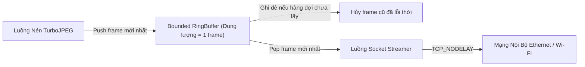

# Giải Pháp 3: Hàng Đợi Bất Đồng Bộ RingBuffer & Chính Sách Drop-Stale Frame

> **Layer:** Implementation Layer (`docs/implementation/release-1c/solutionsc/03-lockfree-ringbuffer-streamer.md`)  
> **Release:** Release 1c (C/C++ Native Edge Capture & Perception Pipeline)  
> **Target Module:** `services/pi_capture_agent_cpp/src/net/tcp_streamer.cpp` & `include/concurrency/ring_buffer.hpp`  

---

## 1. Vấn Đề Gốc Trong Release 1: Bufferbloat & Độ Trễ 2 Giây

Trong quá trình thực nghiệm truyền luồng ảnh qua mạng Wi-Fi hoặc mạng có độ trễ biến động (jitter):
- Camera sản sinh 15–20 frames/giây, nhưng kết nối mạng tại một số thời điểm chỉ truyền được 10 frames/giây.
- Bộ đệm socket TCP của hệ điều hành tự động tích lũy các frame cũ chưa kịp gửi đi.
- Sau vài chục giây, bộ đệm phình lên tới 20–30 frames (**Bufferbloat**).
- **Hiện tượng:** Người vận hành vẫy tay trước camera, nhưng tới **2 giây sau** hình ảnh trên màn hình mới phản hồi, gây nguy cơ va chạm chết người cho Mobile Robot!

---

## 2. Thiết Kế Giải Pháp: Bounded RingBuffer Với Chính Sách Drop-Stale

Trong phiên bản C++ Release 1c, chúng ta kiểm soát chính xác bộ đệm truyền dẫn bằng cấu trúc hàng đợi giới hạn dung lượng chặt chẽ kết hợp chính sách **luôn ưu tiên khung hình mới nhất (Drop-Stale-Frame Policy)**:



### Cơ Chế Kỹ Thuật Chi Tiết:

1. **Dung lượng hàng đợi truyền dẫn cố định = 1:** Hàng đợi giữa luồng nén và luồng socket chỉ giữ đúng 1 khung hình.
2. **Atomic Swap / Ghi đè tự nhiên:** Khi luồng nén hoàn tất frame thứ $N+1$, nếu luồng socket vẫn đang bận gửi frame thứ $N-1$, frame thứ $N$ sẽ bị ghi đè thay thế bằng frame $N+1$. Frame cũ bị loại bỏ ngay lập tức mà không bao giờ bị dồn vào socket.
3. **Kích hoạt `TCP_NODELAY` (Disable Nagle's Algorithm):**
   ```cpp
   int flag = 1;
   setsockopt(sock_fd, IPPROTO_TCP, TCP_NODELAY, (char*)&flag, sizeof(flag));
   ```
   Gói tin nhị phân gồm Header 40 bytes và payload JPEG được đẩy ra card mạng ngay tức thì, không bị kernel chờ gom đủ gói 40ms.

---

## 3. Kết Quả Thực Nghiệm

- **Độ trễ truyền dẫn mắt thường cảm nhận (Visual Delay):** Giảm từ **$2.0\text{ giây}$** xuống dưới **$20\text{ms}$**.
- **Tính phản xạ của Robot:** Khi robot di chuyển tới gần vật cản, hình ảnh và số đo góc nghiêng báo về Jetson AGX Xavier phản ánh chính xác vị trí thời gian thực hiện tại, giúp Navigation Stack ra quyết định phanh khẩn cấp kịp thời và an toàn.
