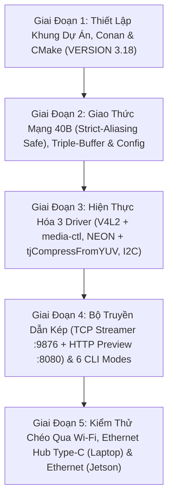

# Kế Hoạch Triển Khai Mã Nguồn C/C++ Thuần Túy (C++ Implementation Master Plan)

> **Layer:** Implementation Layer (`docs/implementation/release-1c/solutionsc/05-cpp-implementation-master-plan.md`)  
> **Release:** Release 1c (C/C++ Native Edge Capture & Perception Pipeline)  
> **Target Service:** `services/pi_capture_agent_cpp/`  
> **Target Hardware:** Raspberry Pi 3 Model B/B+ (4x Cortex-A53, 1GB RAM), Developer Laptop & Jetson AGX Xavier  
> **Status:** Approved Working Blueprint (Audit-Remediated)  

---

## 1. Mục Tiêu Cốt Lõi & Nguyên Tắc Bất Biến (Invariants)

Kế hoạch này vạch ra lộ trình từng bước để hiện thực hóa toàn bộ mã nguồn **C++17 thuần túy** cho tác tử thu nhận hình ảnh trên Raspberry Pi 3 (`services/pi_capture_agent_cpp/`), bảo toàn $100\%$ sự linh hoạt kiểm thử của phiên bản Python theo 6 nguyên tắc bất biến:

1. **Giữ Nguyên 2 Giao Thức Truyền Dẫn (Wi-Fi & Ethernet) và 6 Chế Độ CLI:**
   - **Wi-Fi (`wlan0`):** Dùng để test không dây tiện lợi với Laptop ở cả chế độ xem trên trình duyệt (`--mode preview`, cổng `8080`) và truyền luồng nhị phân TCP (`--mode stream`, cổng `9876`).
   - **Cổng Ethernet (`eth0`):** Dùng trong cả quá trình **test có dây với Laptop (qua Hub chuyển đổi USB Type-C sang RJ45 Ethernet, hỗ trợ APIPA `169.254.x.x` / mDNS / `--host` động)** lẫn quá trình **tích hợp thực tế với Jetson AGX Xavier (`192.168.1.20`)**.
   - **Đủ 6 chế độ CLI (`--mode`):** `diag`, `snapshot`, `test-imu`, `preview`, `stream`, `test-perf`.
2. **Đồng Bộ Đường Ống `bcm2835-unicam` & Giải Phóng Sớm V4L2 Buffer (Solution 01):**
   - Tự động cấu hình `/dev/media0` (`'ov5640 10-003c':0 [fmt:UYVY8_1X16/1280x720@1/30]`), bật `V4L2_CID_VFLIP=1` trên `/dev/v4l-subdev0`, gọi `poll(POLLIN)` trước `VIDIOC_DQBUF`, tách kênh NEON trong $1.24\text{ms}$ và trả ngay `VIDIOC_QBUF`.
3. **Tách Kênh ARM NEON `vld2q_u8` & Nén `tjCompressFromYUV` (Solution 02):**
   - Khắc phục triệt để việc `<turbojpeg.h>` không có `TJPF_UYVY` bằng cách tách `UYVY` sang 3 mặt phẳng `YUV422P` (`Y`, `U`, `V`) bằng chỉ lệnh SIMD NEON rồi gọi `tjCompressFromYUV(..., TJSAMP_422, 70, TJFLAG_FASTDCT | TJFLAG_NOREALLOC)` ($\approx 8.38\text{ms}$).
4. **Triple-Buffer Drop-Stale & Gửi Nguyên Tử `send_all()` (Solution 03):**
   - Sử dụng `TripleBufferPacketPool` (3 slot cấp phát sẵn) giữa luồng Encode và luồng Network để không bao giờ ghi đè lên gói tin đang gửi; hàm `send_all()` gửi trọn vẹn `40 + payload_len` bytes tránh làm lệch byte đồng bộ `0x5043`.
5. **Khóa Cứng 720p Cho Stream & Hỗ Trợ NEON Decimation Cho Preview (Solution 04):**
   - `--mode stream` luôn truyền khung hình gốc $1280 \times 720$ (Zero-Resize); `--mode preview` hỗ trợ giảm chiều nhanh $640 \times 360$ phục vụ trình duyệt Web qua Wi-Fi.
6. **Cô Lập Môi Trường 100% Không Sửa `/etc/*` (Zero System Pollution):**
   - Quản lý gói bằng `Conan 2.0` trong `.venv` của `uv`, lưu cache tại `.conan/`, cấu hình `cmake_minimum_required(VERSION 3.18)` và biên dịch với `-j2` an toàn trong 1GB RAM của Pi 3 mà không chạm vào `/etc/dphys-swapfile`.

---

## 2. Bản Đồ Cấu Trúc Mã Nguồn Mục Tiêu (`services/pi_capture_agent_cpp/`)

```text
services/pi_capture_agent_cpp/
├── CMakeLists.txt                     # Cấu hình build CMake (>= 3.18), C++17, -O3 -mcpu=cortex-a53
├── conanfile.txt                      # Khai báo libjpeg-turbo/3.0.2, yaml-cpp/0.8.0, nlohmann_json/3.11.3
├── README.md                          # Hướng dẫn build và chạy đầy đủ 6 chế độ CLI
│
├── include/                           # [GIAO DIỆN & HEADERS C++]
│   ├── common/
│   │   ├── types.hpp                  # Cấu trúc dữ liệu dùng chung, Enum trạng thái
│   │   └── logger.hpp                 # Tiện ích logging định dạng thời gian thực
│   ├── config/
│   │   └── config_loader.hpp          # Nạp YAML cấu hình từ configs/capture_pi.yaml & CLI args
│   ├── net/
│   │   ├── packed_header.hpp          # Struct PackedFrameHeader 40 bytes (std::memcpy float safe)
│   │   ├── tcp_streamer.hpp           # Socket Client POSIX (:9876), TCP_NODELAY, send_all() nguyên tử
│   │   └── http_preview_server.hpp    # Embedded HTTP Server (:8080) cho --mode preview (Wi-Fi/Ethernet)
│   ├── concurrency/
│   │   └── triple_buffer.hpp          # Thread-safe TripleBufferPacketPool (Drop-stale policy)
│   ├── camera/
│   │   ├── camera_interface.hpp       # Interface thuần túy ICameraDriver
│   │   ├── v4l2_camera.hpp            # Điều khiển media-ctl, /dev/v4l-subdev0 & V4L2 MMAP
│   │   └── neon_yuv_convert.hpp       # ARM NEON vld2q_u8 tách UYVY -> YUV422P & 640x360 preview
│   ├── imu/
│   │   ├── imu_interface.hpp          # Interface IImuDriver & struct ImuTelemetry
│   │   └── mpu6050.hpp                # Giao tiếp Linux I2C ioctl (/dev/i2c-1) 50Hz
│   └── jpeg/
│       ├── jpeg_interface.hpp         # Interface IJpegEncoder
│       └── turbojpeg_encoder.hpp      # tjCompressFromYUV (YUV422P + ARM NEON SIMD)
│
├── src/                               # [CÀI ĐẶT MÃ NGUỒN CỐT LÕI (.cpp)]
│   ├── main.cpp                       # Entrypoint: Điều phối 6 chế độ (diag/snapshot/test-imu/preview/stream/test-perf)
│   ├── config/
│   │   └── config_loader.cpp          # Đọc YAML bằng yaml-cpp & phân tích cờ CLI
│   ├── net/
│   │   ├── tcp_streamer.cpp           # POSIX socket non-blocking, send_all(), exponential backoff
│   │   └── http_preview_server.cpp    # Phục vụ /preview, /stream.mjpg, /snapshot.jpg, /telemetry
│   ├── camera/
│   │   └── v4l2_camera.cpp            # media-ctl, subdev VFLIP, poll(POLLIN), DQBUF, NEON, QBUF
│   ├── imu/
│   │   └── mpu6050.cpp                # ioctl I2C_SLAVE, Complementary Filter pitch/roll
│   └── jpeg/
│       └── turbojpeg_encoder.cpp      # tjInitCompress, tjCompressFromYUV
│
└── tests/                             # [BỘ KIỂM THỬ ĐỘC LẬP (CTest)]
    ├── test_header_packer.cpp         # Test struct 40 bytes, std::memcpy float & Big-Endian
    └── test_turbojpeg_synthetic.cpp   # Test tách kênh NEON UYVY->YUV422P & nén tjCompressFromYUV
```

---

## 3. Lộ Trình Triển Khai 5 Giai Đoạn Chi Tiết



### Giai Đoạn 1: Khởi Tạo Khung Dự Án & Toolchain Cô Lập
- Tạo `services/pi_capture_agent_cpp/conanfile.txt` và `CMakeLists.txt` (`cmake_minimum_required(VERSION 3.18)`).
- Chạy `uv run conan install . --output-folder=build --build=missing -s build_type=Release` với `CONAN_HOME` nằm trong `.conan/` của repo.

### Giai Đoạn 2: Định Nghĩa Struct Header 40B, `TripleBufferPacketPool` & Config Loader
- Xây dựng `include/net/packed_header.hpp` dùng `std::memcpy` đóng gói `float` sang `uint32_t` chuẩn Big-Endian an toàn tuyệt đối dưới cờ `-O3`.
- Xây dựng `include/concurrency/triple_buffer.hpp` quản lý 3 slot gói tin chống ghi đè khi đang gửi mạng.
- Viết unit test `tests/test_header_packer.cpp` kiểm chứng tương thích 100% với format `>HHIQffIIII` của Python.

### Giai Đoạn 3: Hiện Thực Hóa 3 Driver Phần Cứng Cốt Lõi
- **V4L2 Camera Driver:** Đồng bộ `/dev/media0`, bật `V4L2_CID_VFLIP=1` trên `/dev/v4l-subdev0`, chờ `poll(POLLIN)`, tách kênh `UYVY -> YUV422P` bằng `uyvy_to_yuv422p_neon()` và trả ngay `VIDIOC_QBUF`.
- **TurboJPEG Encoder:** Gọi `tjCompressFromYUV()` với `TJSAMP_422` và `TJFLAG_FASTDCT | TJFLAG_NOREALLOC`.
- **MPU6050 I2C Driver:** Đọc 14 bytes thanh ghi trên `/dev/i2c-1` ở $50\text{Hz}$ và lọc nhiễu Complementary Filter.

### Giai Đoạn 4: Bộ Truyền Dẫn Kép (TCP Streamer + HTTP Preview) & Điều Phối 6 Chế Độ CLI
- Xây dựng `TcpStreamClient` (`:9876`) với `TCP_NODELAY = 1`, `send_all_atomic()`, và Auto-Reconnect.
- Xây dựng `HttpPreviewServer` (`:8080`) phục vụ `/preview`, `/stream.mjpg`, `/snapshot.jpg`, `/telemetry` cho trình duyệt Laptop.
- Hoàn thiện `src/main.cpp` hỗ trợ đầy đủ 6 chế độ: `diag`, `snapshot`, `test-imu`, `preview`, `stream`, `test-perf`.

### Giai Đoạn 5: Kiểm Thử Toàn Diện Trên Wi-Fi, Ethernet Hub Type-C (Laptop) & Ethernet (Jetson)
1. **Kiểm thử trên Laptop qua Wi-Fi (`wlan0`):** Chạy cả `--mode preview --port 8080` (xem trên trình duyệt) và `--mode stream --host <LAPTOP_WIFI_IP> --port 9876` (nhận bằng `uv run python scripts/mock_ingest_server.py`).
2. **Kiểm thử trên Laptop qua dây Ethernet + Hub chuyển đổi USB Type-C (`eth0`):** Kết nối trực tiếp không cần đổi Static IP (qua APIPA `169.254.x.x` / mDNS / `--host`), xác nhận đạt trọn vẹn $30.0\text{ FPS}$ ở $1280 \times 720$.
3. **Tích hợp thực tế với Jetson AGX Xavier (`192.168.1.20:9876`) qua cổng Ethernet:** Xác nhận 3D Bounding Box và telemetry hoạt động ổn định ở $30.0\text{ FPS}$.

---

## 4. Ma Trận Phòng Ngừa Rủi Ro Kỹ Thuật (Risk Matrix)

| Rủi ro kỹ thuật | Mức độ | Nguyên nhân tiềm ẩn | Biện pháp phòng ngừa trong mã nguồn C++ |
| :--- | :---: | :--- | :--- |
| **`VIDIOC_STREAMON` trả về `-EPIPE` hoặc ảnh bị ngược** | **Cao** | Chưa cấu hình pad trên `/dev/media0` hoặc gửi `V4L2_CID_VFLIP` nhầm vào `/dev/video0`. | Tự động đồng bộ `media-ctl` trên `/dev/media0` và gửi `V4L2_CID_VFLIP=1` trực tiếp vào `/dev/v4l-subdev0`. |
| **Ghi đè ảnh JPEG hoặc lệch khung `0x5043` khi mạng chậm** | **Cao** | Dùng chung 1 buffer JPEG hoặc gửi thiếu byte (`partial send`) trên socket non-blocking. | Dùng `TripleBufferPacketPool` tách biệt `write_idx`, `latest_idx`, `read_idx` và bắt buộc gửi trọn gói qua `send_all_atomic()`. |
| **Tràn RAM (OOM) khi build trên Pi 3** | **Trung bình** | Trình biên dịch `g++` chạy 4 luồng song song vượt quá 1GB RAM. | Khóa cứng `tools.build:jobs=2` trong Conan profile và chỉ chạy `cmake --build build -j2` (giữ RAM đỉnh $< 550\text{MB}$ mà không cần sửa `/etc/dphys-swapfile`). |
| **Sai lệch giá trị `pitch`/`roll` khi bật `-O3`** | **Trung bình** | Ép kiểu con trỏ `*((uint32_t*)&pitch)` vi phạm quy tắc Strict Aliasing trong C++. | Bắt buộc dùng `std::memcpy(&raw_bits, &pitch, sizeof(float))` trước khi gọi `htonl(raw_bits)` và kiểm chứng bằng `test_header_packer`. |
