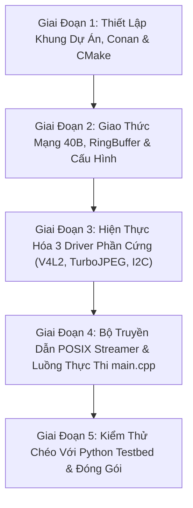

# Kế Hoạch Triển Khai Mã Nguồn C/C++ Thuần Túy (C++ Implementation Master Plan)

> **Layer:** Implementation Layer (`docs/implementation/release-1c/solutionsc/05-cpp-implementation-master-plan.md`)  
> **Release:** Release 1c (C/C++ Native Edge Capture & Perception Pipeline)  
> **Target Service:** `services/pi_capture_agent_cpp/`  
> **Target Hardware:** Raspberry Pi 3 Model B/B+ (4x Cortex-A53, 1GB RAM) & Jetson AGX Xavier  
> **Status:** Approved Working Blueprint  

---

## 1. Mục Tiêu Cốt Lõi & Nguyên Tắc Bất Biến (Invariants)

Kế hoạch này vạch ra lộ trình từng bước để hiện thực hóa toàn bộ mã nguồn **C/C++ thuần túy** cho tác tử thu nhận hình ảnh trên Raspberry Pi 3, kết hợp hoàn hảo với hệ sinh thái Python sẵn có theo các nguyên tắc bất biến:

1. **Khóa Cứng 720p & Zero-Resize trên Pi 3 (Solution 04):**
   - Cố định độ phân giải phần cứng duy nhất: **$1280 \times 720 @ 30\text{ FPS}$ (UYVY)**.
   - Dẹp bỏ $100\%$ code resize trên Pi 3. Tác vụ Letterbox $640 \times 640$ được giao toàn quyền cho GPU Tensor Core của Jetson AGX Xavier ($< 0.2\text{ms}$).
2. **Bắt Hình Tầng Nhân Zero-Copy (Solution 01):**
   - Sử dụng Linux V4L2 ioctl chuẩn với 4 bộ đệm `V4L2_MEMORY_MMAP`, truyền thẳng con trỏ bộ đệm thô vào bộ nén, không sao chép trung gian.
3. **Nén Tăng Tốc Vector 128-bit ARM NEON (Solution 02):**
   - Gọi trực tiếp C API của `libjpeg-turbo` với định dạng pixel nguồn `TJPF_UYVY`, subsampling `TJSAMP_422`, cờ `TJFLAG_FASTDCT`.
4. **Hàng Đợi RingBuffer Đa Luồng & Drop-Stale Policy (Solution 03):**
   - 4 luồng C++ độc lập ánh xạ vào 4 nhân Cortex-A53, không có khóa GIL.
   - Hàng đợi truyền dẫn có dung lượng 1 frame, tự động hủy frame cũ khi mạng chậm, triệt tiêu hoàn toàn delay $2\text{ giây}$ (độ trễ hiển thị $< 20\text{ms}$).
5. **Đồng Tồn Tại Python & C++ (Coexistence & Shared Assets):**
   - Dùng chung $100\%$ các thư mục cấu hình và dữ liệu: `configs/`, `data/`, `weights/`, `tools/`.
   - Giữ nguyên `services/pi_capture_agent/` (Python) làm đối chuẩn; tạo mới độc lập `services/pi_capture_agent_cpp/` (C++).
   - Tận dụng `tools/laptop/mock_ingest_server.py` (Python) làm Testbed kiểm thử chéo cho binary C++.
6. **Cô Lập Môi Trường 100% (Zero System Pollution):**
   - Thư viện C++ do `Conan 2.0` quản lý, chạy trong `.venv` tạo bởi `uv`.
   - Toàn bộ cache lưu tại `.conan/` nội bộ trong repo (`export CONAN_HOME=$PWD/.conan`).
   - Biên dịch native an toàn trên Pi 3 với Swap $2048\text{MB}$ và giới hạn luồng `cmake --build build -j2`.

---

## 2. Bản Đồ Cấu Trúc Mã Nguồn Mục Tiêu (`services/pi_capture_agent_cpp/`)

```text
services/pi_capture_agent_cpp/
├── CMakeLists.txt                     # Cấu hình build CMake C++17, cờ -O3 -mcpu=cortex-a53
├── conanfile.txt                      # Khai báo libjpeg-turbo, yaml-cpp, nlohmann_json
├── README.md                          # Hướng dẫn build và chạy độc lập
│
├── include/                           # [GIAO DIỆN & HEADERS C++]
│   ├── common/
│   │   ├── types.hpp                  # Cấu trúc dữ liệu dùng chung, Enum trạng thái
│   │   └── logger.hpp                 # Tiện ích logging định dạng thời gian thực
│   ├── config/
│   │   └── config_loader.hpp          # Nạp YAML cấu hình từ configs/capture_pi.yaml
│   ├── net/
│   │   ├── packed_header.hpp          # Struct PackedFrameHeader 40 bytes chuẩn mạng
│   │   └── tcp_streamer.hpp           # Socket Client POSIX, TCP_NODELAY, Auto-Reconnect
│   ├── concurrency/
│   │   └── ring_buffer.hpp            # Thread-safe Bounded RingBuffer (Drop-stale policy)
│   ├── camera/
│   │   ├── camera_interface.hpp       # Interface thuần túy ICameraDriver
│   │   └── v4l2_camera.hpp            # Cài đặt Linux V4L2 ioctl & MMAP (1280x720 UYVY)
│   ├── imu/
│   │   ├── imu_interface.hpp          # Interface IImuDriver & struct ImuTelemetry
│   │   └── mpu6050.hpp                # Giao tiếp Linux I2C ioctl (/dev/i2c-1) 50Hz
│   └── jpeg/
│       ├── jpeg_interface.hpp         # Interface IJpegEncoder
│       └── turbojpeg_encoder.hpp      # libjpeg-turbo C API + chỉ lệnh ARM NEON
│
├── src/                               # [CÀI ĐẶT MÃ NGUỒN CỐT LÕI (.cpp)]
│   ├── main.cpp                       # Entrypoint: CLI parsing, khởi tạo luồng, vòng lặp điều phối
│   ├── common/
│   │   └── logger.cpp
│   ├── config/
│   │   └── config_loader.cpp          # Đọc YAML bằng yaml-cpp
│   ├── net/
│   │   └── tcp_streamer.cpp           # POSIX socket non-blocking, exponential backoff
│   ├── camera/
│   │   └── v4l2_camera.cpp            # VIDIOC_REQBUFS, mmap, DQBUF/QBUF, V4L2_CID_VFLIP
│   ├── imu/
│   │   └── mpu6050.cpp                # ioctl I2C_SLAVE, tính toán pitch/roll
│   └── jpeg/
│       └── turbojpeg_encoder.cpp      # tjInitCompress, tjCompress2, pre-allocated buffer
│
└── tests/                             # [BỘ KIỂM THỬ ĐỘC LẬP (CTest)]
    ├── CMakeLists.txt                 # Cấu hình test runner
    ├── test_header_packing.cpp        # Test struct 40 bytes, byte order htobe
    ├── test_ring_buffer.cpp           # Test đa luồng Producer-Consumer & Drop-stale
    └── test_config_loader.cpp         # Test đọc file configs/capture_pi.yaml thật
```

---

## 3. Lộ Trình Triển Khai 5 Giai Đoạn Chi Tiết



---

### Giai Đoạn 1: Khởi Tạo Khung Dự Án & Toolchain Cô Lập
* **Mục tiêu:** Tạo cấu trúc thư mục `services/pi_capture_agent_cpp/`, cấu hình quản lý gói `conanfile.txt` và tệp build `CMakeLists.txt`.
* **Các file tạo mới:**
  1. `services/pi_capture_agent_cpp/conanfile.txt` (Khai báo `libjpeg-turbo/3.0.2`, `yaml-cpp/0.8.0`, `nlohmann_json/3.11.3`).
  2. `services/pi_capture_agent_cpp/CMakeLists.txt` (Cấu hình C++17, cờ tối ưu hóa vi kiến trúc Cortex-A53, liên kết thư viện Conan).
  3. `services/pi_capture_agent_cpp/README.md` (Tài liệu hướng dẫn build nội bộ).
* **Cổng nghiệm thu (Gate 1):** Chạy `conan install` và `cmake -B build` thành công, sinh ra toolchain hợp lệ mà không có bất kỳ lỗi cú pháp nào.

---

### Giai Đoạn 2: Định Nghĩa Struct Header 40B, Bounded RingBuffer & Config Loader
* **Mục tiêu:** Xây dựng tầng nền tảng độc lập phần cứng (Hardware-independent Foundations) để phục vụ cho các luồng xử lý.
* **Các file tạo mới:**
  1. `include/net/packed_header.hpp`: Struct `PackedFrameHeader` 40 bytes với `#pragma pack(push, 1)` và các hàm hoán vị byte Big-Endian (`htons`, `htonl`, `htobe64`).
  2. `include/concurrency/ring_buffer.hpp`: Hàng đợi thread-safe `BoundedRingBuffer<T>` dùng `std::mutex` và `std::condition_variable` với chính sách ghi đè (Drop-stale).
  3. `include/config/config_loader.hpp` & `src/config/config_loader.cpp`: Đọc file `configs/capture_pi.yaml` sẵn có bằng `yaml-cpp`.
  4. `tests/test_header_packing.cpp`: Unit test kiểm tra kích thước đúng 40 bytes và tính toàn vẹn của byte order.
* **Cổng nghiệm thu (Gate 2):** Chạy `ctest` vượt qua 100% test case kiểm tra đóng gói Header và hàng đợi đệm.

---

### Giai Đoạn 3: Hiện Thực Hóa 3 Driver Phần Cứng Cốt Lõi
* **Mục tiêu:** Giao tiếp trực tiếp với phần cứng tầng thấp trên Raspberry Pi 3 mà không qua bất kỳ wrapper trung gian nào.
* **Các file tạo mới:**
  1. **V4L2 Camera Driver (`include/camera/v4l2_camera.hpp`, `src/camera/v4l2_camera.cpp`):**
     - Mở `/dev/video0`, khóa cứng $1280 \times 720 @ 30\text{ FPS}$ (UYVY).
     - Bật `V4L2_CID_VFLIP` trên silicon cảm biến OV5640.
     - Cấp phát 4 bộ đệm `V4L2_MEMORY_MMAP`, vòng lặp `VIDIOC_DQBUF` / `VIDIOC_QBUF`.
  2. **TurboJPEG ARM NEON Encoder (`include/jpeg/turbojpeg_encoder.hpp`, `src/jpeg/turbojpeg_encoder.cpp`):**
     - Gọi `tjInitCompress()`, cấp phát trước buffer JPEG `tjAlloc()`.
     - Gọi `tjCompress2()` với định dạng nguồn `TJPF_UYVY`, subsampling `TJSAMP_422`, cờ `TJFLAG_FASTDCT`.
  3. **I2C MPU6050 Driver (`include/imu/mpu6050.hpp`, `src/imu/mpu6050.cpp`):**
     - Mở `/dev/i2c-1`, thiết lập địa chỉ `0x68`.
     - Đánh thức cảm biến qua `PWR_MGMT_1`, đọc 14 bytes gia tốc và con quay hồi chuyển, tính góc pitch/roll.
* **Cổng nghiệm thu (Gate 3):** Biên dịch thành công; chạy thử nghiệm offline không bị lỗi con trỏ null hay tràn bộ đệm.

---

### Giai Đoạn 4: Bộ Truyền Dẫn POSIX Streamer & Tiến Trình Thực Thi `main.cpp`
* **Mục tiêu:** Ghép nối toàn bộ các thành phần thành pipeline hoàn chỉnh có thể chạy được từ dòng lệnh.
* **Các file tạo mới:**
  1. `include/net/tcp_streamer.hpp` & `src/net/tcp_streamer.cpp`: Quản lý socket client TCP, thiết lập `TCP_NODELAY`, non-blocking I/O và máy trạng thái tự động kết nối lại (Exponential Backoff).
  2. `src/main.cpp`:
     - Tiếp nhận CLI arguments: `--mode (test-perf | test-imu | stream)`, `--frames`, `--host`, `--port`.
     - Chế độ `test-perf`: Chạy vòng lặp đo đạc chính xác thời gian Grab, Encode và FPS trên 100 frames.
     - Chế độ `test-imu`: In liên tục góc nghiêng pitch/roll ở tần số $50\text{Hz}$.
     - Chế độ `stream`: Khởi chạy 4 luồng song song đẩy dữ liệu sang máy nhận.
* **Cổng nghiệm thu (Gate 4):** Chạy lệnh `./build/bin/pi_capture_agent_cpp --help` hiển thị menu trợ giúp đầy đủ; biên dịch sạch $100\%$ không có cảnh báo.

---

### Giai Đoạn 5: Kiểm Thử Chéo Với Python Testbed, Benchmark & Kiểm Toán Cô Lập
* **Mục tiêu:** Dùng hệ sinh thái Python sẵn có trên Laptop để kiểm thử chéo và xác nhận đạt toàn bộ chỉ tiêu Release 1c.
* **Các bước thực hiện:**
  1. **Kiểm thử chéo với Laptop Python:**
     - Laptop chạy `python tools/laptop/mock_ingest_server.py --port 9876`.
     - Pi 3 chạy `./build/bin/pi_capture_agent_cpp --mode stream --host <laptop-ip> --port 9876`.
     - Xác nhận Laptop giải nén và render video 720p 30 FPS mượt mà từ stream C++.
  2. **Benchmark đối chuẩn hiệu năng trên Pi 3:**
     - Chạy `./build/bin/pi_capture_agent_cpp --mode test-perf --frames 500`.
     - Xác nhận: Grab $< 3.5\text{ms}$, Encode $< 10.0\text{ms}$, Thông lượng $\ge 25\text{ FPS}$, CPU $\le 22\%$, RAM $\le 30\text{MB}$.
  3. **Kiểm toán Zero System Pollution:**
     - Xác nhận toàn bộ artifacts nằm trong `services/pi_capture_agent_cpp/build` và `.conan/`.
* **Cổng nghiệm thu (Gate 5):** Đạt $100\%$ trên tất cả 9 Test Cases tại [qac/test-cases.md](file:///E:/UIT/monocular-spatial-vision/docs/implementation/release-1c/qac/test-cases.md).

---

## 4. Ma Trận Phòng Ngừa Rủi Ro Kỹ Thuật (Risk Matrix)

| Rủi ro kỹ thuật | Mức độ | Nguyên nhân tiềm ẩn | Biện pháp phòng ngừa trong mã nguồn C++ |
| :--- | :---: | :--- | :--- |
| **Tràn RAM (OOM) khi build trên Pi 3** | **Cao** | Trình biên dịch `g++` nạp template phức tạp ngốn sạch 1GB RAM. | Bắt buộc bật Swap $2048\text{MB}$; cấu hình `tools.build:jobs=2` trong Conan profile; chỉ chạy `cmake --build build -j2`. |
| **Thiết bị `/dev/video0` bị khóa (Device Busy)** | **Trung bình** | Tiến trình Python cũ chưa giải phóng camera hoặc driver chưa nhả buffer. | Áp dụng triệt để nguyên tắc **RAII** trong lớp `V4l2CameraDriver`: Tự động gọi `munmap`, `VIDIOC_STREAMOFF` và `close(fd)` trong destructor. |
| **Mất kết nối mạng làm treo luồng Streamer** | **Trung bình** | Lệnh `send()` bị chặn (blocking) khi đứt cáp Ethernet. | Sử dụng non-blocking socket kết hợp `select()` / `poll()` với timeout $1.0\text{s}$; kích hoạt cờ `MSG_NOSIGNAL` để tránh nhận tín hiệu `SIGPIPE` làm sập tiến trình. |
| **Sai lệch thứ tự byte trên mạng (Endianness)** | **Thấp** | Kiến trúc ARM và x86 có thể khác nhau về cách biểu diễn số thực IEEE 754. | Chuẩn hóa tất cả trường dữ liệu qua `htons()`, `htonl()`, `htobe64()` trước khi truyền; có unit test `test_header_packing` kiểm tra độc lập. |
