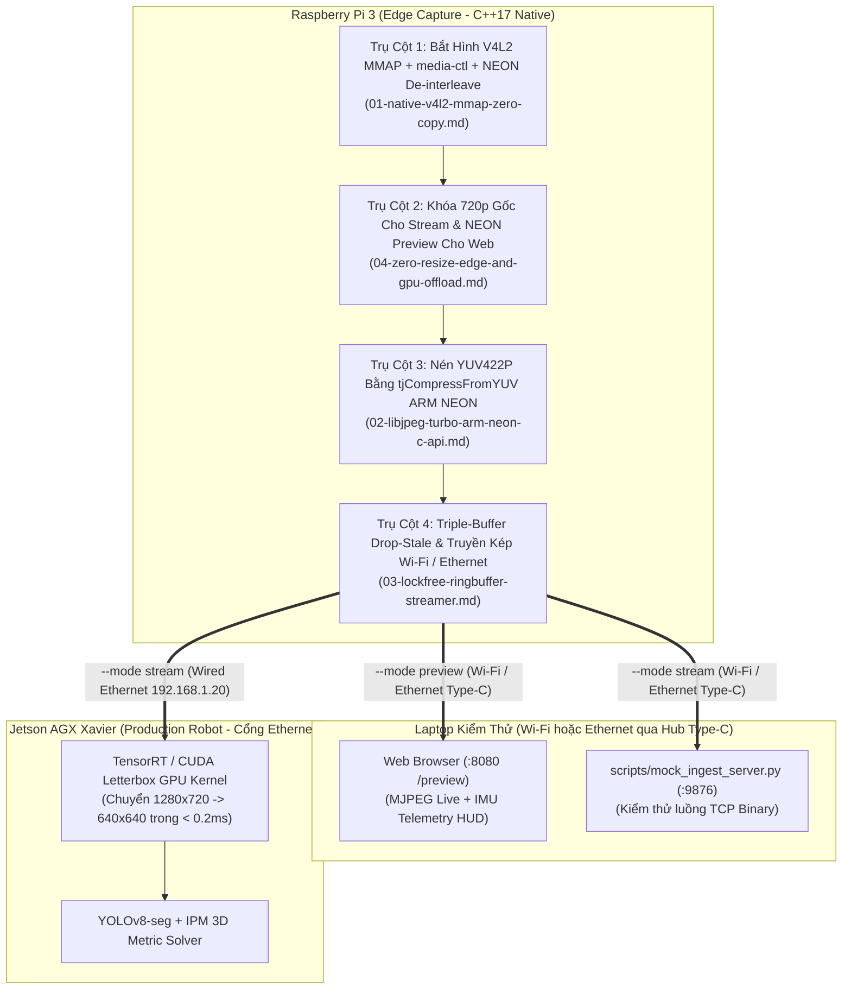

# Danh Mục Giải Pháp Tối Ưu C/C++ Thuần Túy (C++ Solutions Index)

> **Layer:** Implementation Layer (`docs/implementation/release-1c/solutionsc/README.md`)  
> **Release:** Release 1c (C/C++ Native Edge Capture & Perception Pipeline)  
> **Mục tiêu:** Hệ thống hóa 4 giải pháp kỹ thuật cốt lõi và Kế hoạch triển khai mã nguồn C++17 thuần túy, phát huy tối đa sức mạnh phần cứng của camera Pcam 5C (OV5640) và vi xử lý ARM Cortex-A53 trên Raspberry Pi 3, đồng thời giữ nguyên $100\%$ cả 2 giao thức truyền dẫn (Wi-Fi & Ethernet) và 6 chế độ kiểm thử như phiên bản Python.

---

## 1. Bản Đồ 4 Trụ Cột Tối Ưu Hóa & Bản Kế Hoạch Triển Khai

Release 1c định hình kiến trúc C++17 tinh gọn trên Raspberry Pi 3, kết nối linh hoạt với cả **Laptop (qua Wi-Fi hoặc dây Ethernet gắn Hub chuyển đổi USB Type-C)** và **Jetson AGX Xavier (qua cổng Ethernet)**:

---

## 2. Chi Tiết Các Tệp Giải Pháp & Kế Hoạch

| Tệp tài liệu | Tiêu đề kỹ thuật | Vấn đề giải quyết | Kết quả đạt được |
| :--- | :--- | :--- | :--- |
| [01-native-v4l2-mmap-zero-copy.md](file:///E:/UIT/monocular-spatial-vision/docs/implementation/release-1c/solutionsc/01-native-v4l2-mmap-zero-copy.md) | **Đồng bộ `bcm2835-unicam`, V4L2 MMAP & Tách Kênh NEON `vld2_u8` Trả Buffer Sớm** | Loại bỏ 4 tầng sao chép của OpenCV/Python, sửa lỗi `-EPIPE` trên `/dev/media0`, bật `VFLIP` trên `/dev/v4l-subdev0` và giải phóng DMA buffer ngay sau tách kênh NEON. | Giảm thời gian giữ buffer DMA xuống $\mathbf{1.24\text{ms}}$/frame. |
| [02-libjpeg-turbo-arm-neon-c-api.md](file:///E:/UIT/monocular-spatial-vision/docs/implementation/release-1c/solutionsc/02-libjpeg-turbo-arm-neon-c-api.md) | **Tách Kênh ARM NEON `UYVY -> YUV422P` & Nén `tjCompressFromYUV`** | Thay thế `cv2.imencode()` chậm chạp và khắc phục việc `<turbojpeg.h>` không có `TJPF_UYVY` bằng đường ống `vld2_u8` + `tjCompressFromYUV(TJSAMP_422)`. | Rút ngắn thời gian nén từ $60.6\text{ms}$ xuống $\mathbf{8.38\text{ms}}$/frame @ 720p. |
| [03-lockfree-ringbuffer-streamer.md](file:///E:/UIT/monocular-spatial-vision/docs/implementation/release-1c/solutionsc/03-lockfree-ringbuffer-streamer.md) | **Triple-Buffer Drop-Stale, Gửi Nguyên Tử `send_all()` & Truyền Dẫn Kép Wi-Fi / Ethernet** | Ngăn chặn Bufferbloat trễ $2\text{ giây}$, chống ghi đè gói tin đang gửi và hỗ trợ cả Wi-Fi lẫn Ethernet (Hub Type-C Laptop & Jetson). | Độ trễ hiển thị $\mathbf{< 30\text{ms}}$, `0` lỗi lệch khung `0x5043`. |
| [04-zero-resize-edge-and-gpu-offload.md](file:///E:/UIT/monocular-spatial-vision/docs/implementation/release-1c/solutionsc/04-zero-resize-edge-and-gpu-offload.md) | **Khóa Cứng 720p Gốc Cho Luồng Stream & Đẩy Tác Vụ Letterbox Sang GPU Jetson** | Loại bỏ điểm nghẽn `cv2.resize()` trên Pi 3 và lỗi desync xung PLL trên OV5640; hỗ trợ riêng NEON decimation `640x360` cho `--mode preview`. | Tiết kiệm $100\%$ CPU resize khi stream, giữ ảnh 720p nét căng cho Jetson. |
| [05-cpp-implementation-master-plan.md](file:///E:/UIT/monocular-spatial-vision/docs/implementation/release-1c/solutionsc/05-cpp-implementation-master-plan.md) | **Kế Hoạch Triển Khai Mã Nguồn C/C++ Thuần Túy (Master Plan)** | Bản thiết kế lộ trình 5 giai đoạn từ thiết lập môi trường cô lập, 3 driver phần cứng, 6 chế độ CLI đến kiểm thử chéo qua Wi-Fi & Ethernet. | Blueprint hành động hoàn chỉnh trước khi viết code. |

---

## 3. Nguyên Tắc Thiết Kế Trọng Tâm

1. **Giữ Nguyên 2 Phương Thức Truyền Dẫn (Wi-Fi & Ethernet) và 6 Chế Độ CLI:** Dùng Wi-Fi để tiện test không dây với Laptop (`--mode preview` & `--mode stream`), dùng dây Ethernet qua Hub chuyển đổi USB Type-C để test băng thông cao với Laptop, và dùng cổng Ethernet trực tiếp khi tích hợp với Jetson AGX Xavier.
2. **Không Resize Trên Pi 3 Ở Chế Độ `--mode stream`:** Cảm biến xuất chuẩn $1280 \times 720$ thì Pi 3 nén và truyền thẳng $1280 \times 720$. Tác vụ Letterbox $640 \times 640$ giao $100\%$ cho GPU của Jetson AGX Xavier xử lý trong $< 0.2\text{ms}$.
3. **Trả Sớm Bộ Đệm V4L2 & An Toàn Đa Luồng Với Triple-Buffer:** Tách kênh `UYVY -> YUV422P` bằng NEON trong $1.24\text{ms}$ rồi trả ngay `VIDIOC_QBUF`; dùng 3 slot gói tin độc lập giữa luồng Encode và luồng Network để không bao giờ làm hỏng gói tin đang truyền.
