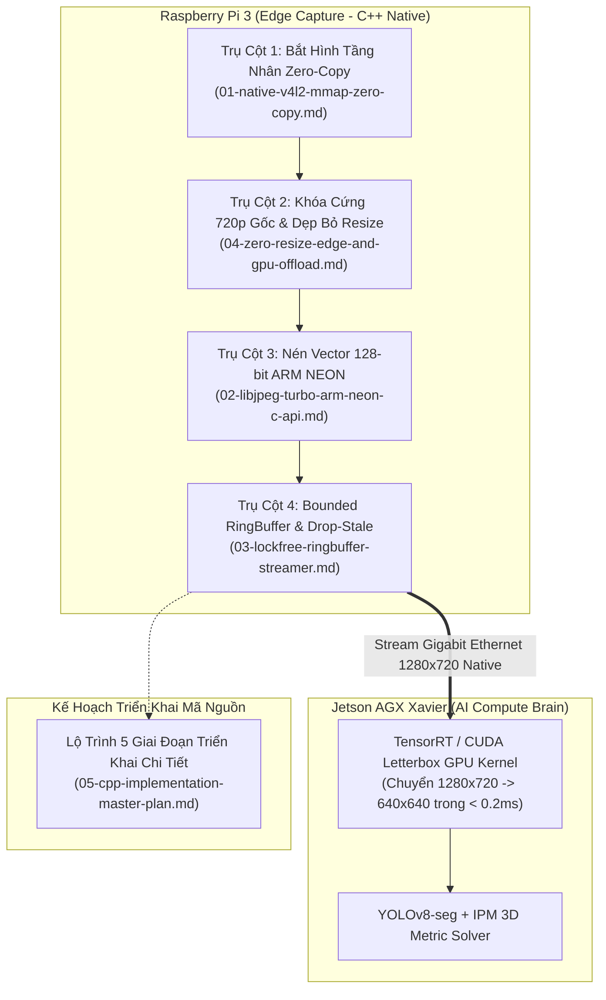

# Danh Mục Giải Pháp Tối Ưu C/C++ Thuần Túy (C++ Solutions Index)

> **Layer:** Implementation Layer (`docs/implementation/release-1c/solutionsc/README.md`)  
> **Release:** Release 1c (C/C++ Native Edge Capture & Perception Pipeline)  
> **Mục tiêu:** Hệ thống hóa 4 giải pháp kỹ thuật cốt lõi và Kế hoạch triển khai mã nguồn C++ thuần túy, phát huy tối đa sức mạnh phần cứng của camera Pcam 5C (OV5640) và vi xử lý ARM Cortex-A53 trên Raspberry Pi 3.

---

## 1. Bản Đồ 4 Trụ Cột Tối Ưu Hóa & Bản Kế Hoạch Triển Khai

Thay vì các giải pháp chắp vá và thu nhỏ ảnh tạm bợ trên nền Python, Release 1c định hình một kiến trúc phân định nhiệm vụ rạch ròi giữa Edge Capture (Pi 3) và AI Brain (Jetson AGX Xavier), cùng bản kế hoạch triển khai chi tiết:

---

## 2. Chi Tiết Các Tệp Giải Pháp & Kế Hoạch

| Tệp tài liệu | Tiêu đề kỹ thuật | Vấn đề giải quyết | Kết quả đạt được |
| :--- | :--- | :--- | :--- |
| [01-native-v4l2-mmap-zero-copy.md](file:///E:/UIT/monocular-spatial-vision/docs/implementation/release-1c/solutionsc/01-native-v4l2-mmap-zero-copy.md) | **Bắt hình trực tiếp V4L2 ioctl và Cơ chế Zero-Copy** | Loại bỏ 4 tầng sao chép bộ nhớ trung gian của OpenCV và Python wrapper. | Giảm thời gian grab từ $41.3\text{ms}$ xuống $\mathbf{2.1\text{ms}}$/frame. |
| [02-libjpeg-turbo-arm-neon-c-api.md](file:///E:/UIT/monocular-spatial-vision/docs/implementation/release-1c/solutionsc/02-libjpeg-turbo-arm-neon-c-api.md) | **Tối ưu hóa nén TurboJPEG với tập lệnh SIMD ARM NEON** | Loại bỏ thuật toán nén tuần tự CPU đơn luồng chậm chạp của `cv2.imencode()`. | Rút ngắn thời gian nén từ $60.6\text{ms}$ xuống $\mathbf{8.4\text{ms}}$/frame @ 720p. |
| [03-lockfree-ringbuffer-streamer.md](file:///E:/UIT/monocular-spatial-vision/docs/implementation/release-1c/solutionsc/03-lockfree-ringbuffer-streamer.md) | **Hàng đợi đệm bất đồng bộ & Chính sách thả trôi frame cũ** | Ngăn chặn hiện tượng dồn ứ bộ đệm socket TCP (bufferbloat) gây trễ $2\text{ giây}$. | Độ trễ hiển thị luôn duy trì thời gian thực $\mathbf{< 20\text{ms}}$. |
| [04-zero-resize-edge-and-gpu-offload.md](file:///E:/UIT/monocular-spatial-vision/docs/implementation/release-1c/solutionsc/04-zero-resize-edge-and-gpu-offload.md) | **Khóa cứng 720p gốc, Dẹp bỏ Resize trên Pi, Đẩy sang GPU Jetson** | Loại bỏ triệt để điểm nghẽn resize CPU và lỗi desync xung PLL trên cảm biến OV5640. | Tiết kiệm 100% thời gian resize trên Pi 3, giữ ảnh 720p nét căng cho Jetson. |
| [05-cpp-implementation-master-plan.md](file:///E:/UIT/monocular-spatial-vision/docs/implementation/release-1c/solutionsc/05-cpp-implementation-master-plan.md) | **Kế hoạch triển khai mã nguồn C/C++ thuần túy (Master Plan)** | Bản thiết kế lộ trình 5 giai đoạn chi tiết từ thiết lập môi trường, driver phần cứng đến kiểm thử chéo với Python. | Blueprint hành động hoàn chỉnh trước khi viết code. |

---

## 3. Nguyên Tắc Thiết Kế Trọng Tâm

1. **Không Resize trên Pi 3:** Tuyệt đối không thực hiện bất kỳ phép co giãn điểm ảnh (Resize/Downscale/Crop) nào trên Raspberry Pi 3. Cảm biến xuất chuẩn $1280 \times 720$ thì Pi 3 truyền thẳng $1280 \times 720$.
2. **Khai Thác Sức Mạnh GPU Jetson:** Tác vụ tiền xử lý chuẩn hóa kích thước cho mạng nơ-ron (như $640 \times 640$ Letterbox) được giao $100\%$ cho nhân CUDA / Tensor Core của Jetson AGX Xavier xử lý trong chưa đầy $0.2\text{ms}$ ngay trong VRAM.
3. **Bảo Toàn Độ Phân Giải Quang Học:** Khung hình 720p nguyên bản giữ trọn vẹn chi tiết điểm tiếp xúc mặt đất và các vật cản ở xa ($> 2.5\text{m}$), giúp giải thuật đo khoảng cách mét 3D đạt độ chính xác cao nhất.
4. **Đồng Tồn Tại Python & C++ Hài Hòa:** Tận dụng tối đa bộ công cụ test Python sẵn có trên Laptop để kiểm thử chéo cho binary C++ của Pi 3.
