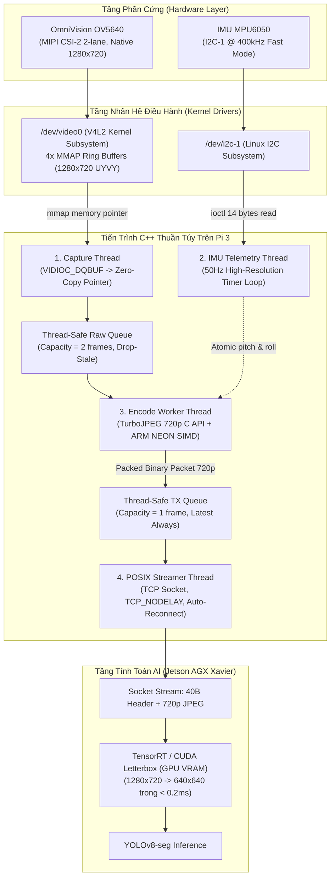
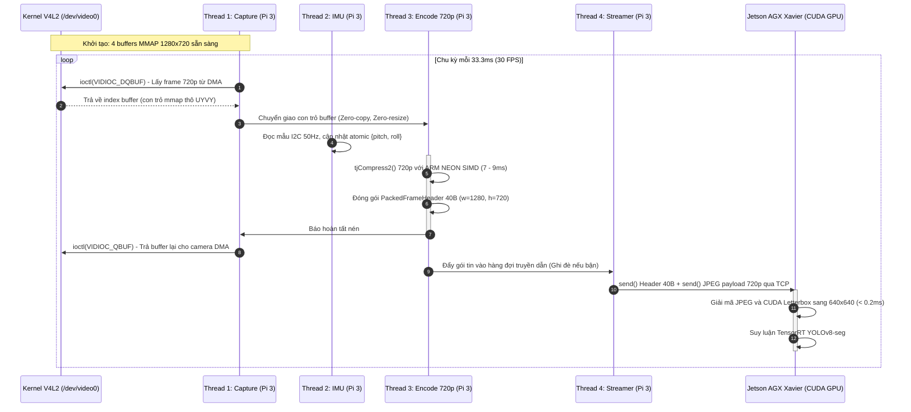
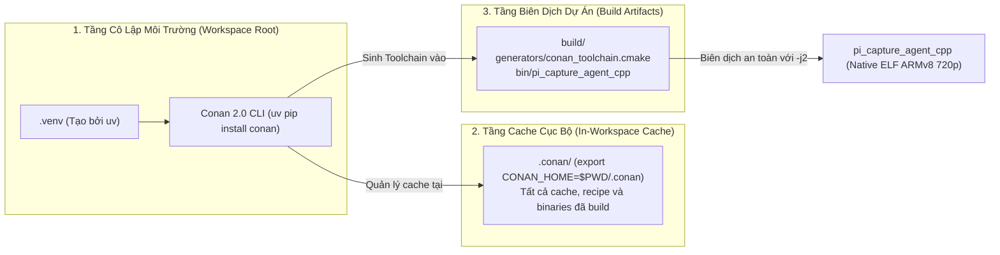

# Technical Design — Release 1c Pure C/C++ Native Pipeline

> **Layer:** Implementation Layer (`docs/implementation/release-1c/technical-design.md`)  
> **Release:** Release 1c (C/C++ Native Edge Capture & Perception Pipeline)  
> **Status:** Approved Baseline  

---

## 1. Multi-threaded Architecture & Concurrency Model

Khác biệt cốt lõi giữa phiên bản C++ và phiên bản Python là khả năng kiểm soát luồng phần cứng ở mức vi xử lý, không bị khóa toàn cục GIL, **khóa cứng khung hình gốc $1280 \times 720$** và loại bỏ hoàn toàn chi phí bản sao bộ nhớ (Zero-copy memory model).

Tiến trình C++ trên Raspberry Pi 3 được thiết kế theo mô hình **4 luồng chuyên biệt độc lập (4 Dedicated Threads)** tương ứng với 4 nhân Cortex-A53:



---

## 2. Chu Trình Xử Lý Khung Hình (Sequence Diagram)



---

## 3. Mô Hình Bộ Nhớ Zero-Copy & Triệt Tiêu Chi Phí Resize

Nhằm tối ưu hóa tài nguyên trên RAM $1\text{GB}$ của Raspberry Pi 3:
1. **Không sao chép bộ đệm camera:** Dữ liệu hình ảnh từ cảm biến OV5640 được phần cứng DMA ghi trực tiếp vào 4 vùng nhớ kernel (`v4l2_buffer`) tại kích thước chuẩn $1280 \times 720 \times 2\text{ bytes} \approx 1.84\text{MB}$. Khi nén ảnh, con trỏ vùng nhớ `mmap_buffers[i]` được truyền thẳng vào hàm `tjCompress2()` của `libjpeg-turbo`.
2. **Loại bỏ 100% chi phí Resize trên Pi 3:** Tuyệt đối không gọi bất kỳ hàm nội suy co nhỏ ảnh nào. Toàn bộ chu kỳ CPU của Pi 3 chỉ dành cho nén SIMD và gửi mạng.
3. **Bộ nhớ nén tái sử dụng (Pre-allocated JPEG Buffer):** Vùng nhớ chứa kết quả JPEG nén được cấp phát trước một lần duy nhất lúc khởi động (`max_jpeg_size = tjBufSize(1280, 720, TJSAMP_422)` $\approx 1.3\text{MB}$). Không có thao tác `malloc()` hay `free()` nào diễn ra trong vòng lặp chính.
4. **Cơ chế thả trôi khung hình (Drop-Stale Policy):** Khi mạng bị nghẽn, hàng đợi truyền dẫn chỉ giữ dung lượng tối đa 1 khung hình. Khung hình mới nén xong sẽ ghi đè trực tiếp lên khung hình cũ nếu khung hình cũ chưa kịp gửi, đảm bảo độ trễ hình ảnh tới đích luôn $< 20\text{ms}$.

---

## 4. Đặc Tả Struct Nhị Phân & Endianness (40 Bytes)

Cấu trúc Binary Header 40 bytes được định nghĩa chặt chẽ bằng ngôn ngữ C để tương thích $100\%$ với socket server trên Jetson AGX Xavier:

```cpp
#pragma pack(push, 1)
struct PackedFrameHeader {
    uint16_t magic;         // 0x5043 ('PC') - Big-Endian
    uint16_t version;       // 1 - Big-Endian
    uint32_t frame_id;      // Số thứ tự khung hình tăng dần - Big-Endian
    uint64_t timestamp_ns;  // Thời gian chụp (Unix epoch nanoseconds) - Big-Endian
    float    pitch_deg;     // Góc nghiêng trục pitch (độ) - IEEE 754 Big-Endian
    float    roll_deg;      // Góc nghiêng trục roll (độ) - IEEE 754 Big-Endian
    uint32_t payload_len;   // Kích thước mảng bytes JPEG 720p - Big-Endian
    uint32_t width;         // Cố định: 1280 - Big-Endian
    uint32_t height;        // Cố định: 720 - Big-Endian
    uint32_t reserved;      // Dự phòng căn lề: 0x00000000 - Big-Endian
};
#pragma pack(pop)
static_assert(sizeof(PackedFrameHeader) == 40, "Header size must be strictly 40 bytes!");
```

Mọi trường số nguyên và số thực dấu phẩy động đều được chuyển đổi sang chuẩn mạng (Network Byte Order - Big-Endian) thông qua `htons()`, `htonl()`, `htobe64()`.

---

## 5. Kiến Trúc Quản Lý Gói & Toolchain (Conan 2.0 + CMake)

Để đảm bảo nguyên tắc bất biến **Zero System Pollution**, toàn bộ cây phụ thuộc C++ được quản lý theo mô hình phân tầng:


