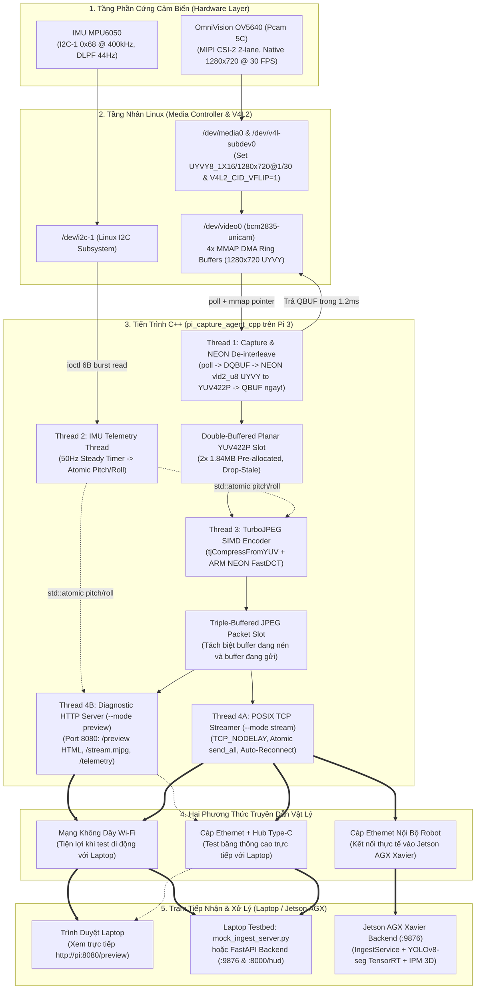
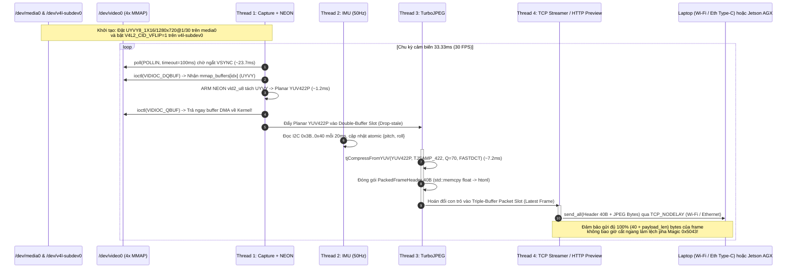

# Technical Design — Release 1c Pure C/C++ Native Pipeline

> **Layer:** Implementation Layer (`docs/implementation/release-1c/technical-design.md`)  
> **Release:** Release 1c (C/C++ Native Edge Capture & Perception Pipeline)  
> **Status:** Approved Baseline (Audited & Revised)  

---

## 1. Kiến Trúc Đa Luồng & Hai Phương Thức Truyền Dẫn (Wi-Fi & Ethernet)

Phiên bản C++ (`services/pi_capture_agent_cpp/`) được thiết kế để khai thác trọn vẹn 4 nhân ARM Cortex-A53 trên Raspberry Pi 3 mà không bị ràng buộc bởi khóa GIL của Python, đồng thời **bảo toàn 100% các phương thức kết nối và kiểm thử như bản Python hiện tại**:
- **Kết nối qua Wi-Fi:** Dành cho việc kiểm thử không dây tiện lợi với Laptop thông qua chế độ `--mode preview` (xem trực tiếp trên trình duyệt tại `http://<pi_wifi_ip>:8080/preview`) hoặc `--mode stream` (bắn gói tin nhị phân về `mock_ingest_server.py` / Backend trên Laptop).
- **Kết nối qua Cáp Ethernet có dây:**
  - *Trong quá trình Dev/Test:* Cắm dây mạng Ethernet từ Pi 3 qua **Hub chuyển đổi Type-C vào Laptop** (sử dụng IP tự động APIPA `169.254.x.x` hoặc DHCP LAN truyền qua cờ `--host <IP_LAPTOP>`) để kiểm thử luồng $1280 \times 720 @ 30\text{ FPS}$ không suy hao.
  - *Khi tích hợp thực tế trên Robot:* Cắm dây mạng Ethernet từ Pi 3 vào Switch / cổng Ethernet của **Jetson AGX Xavier** (`192.168.1.20`).



---

## 2. Chu Trình Xử Lý Khung Hình An Toàn Bộ Nhớ (Sequence Diagram)

Thiết kế dưới đây khắc phục hoàn toàn lỗi thiếu cấu hình `media-ctl`, lỗi `TJPF_UYVY`, lỗi rò rỉ bộ đệm `V4L2_MEMORY_MMAP`, lỗi ghi đè `jpeg_buf_` và lỗi gửi thiếu byte TCP (`Partial Write`):



---

## 3. Cơ Chế Quản Lý Bộ Nhớ Không Rò Rỉ & Không Tranh Chấp (Memory & Concurrency Safety)

1. **Giải phóng V4L2 DMA Buffer tức thời (Zero DMA Buffer Starvation):**
   - Thay vì giữ con trỏ `mmap` của nhân Linux đi xuyên qua hàng đợi sang luồng Encode (dễ gây mất dấu `VIDIOC_QBUF` khi frame bị drop), `Thread 1 (Capture)` sử dụng tập lệnh vector **ARM NEON (`vld2_u8`)** vừa đọc từ vùng nhớ `mmap` vừa tách trực tiếp các byte đan xen `U0 Y0 V0 Y1` vào 3 mặt phẳng `Y`, `U`, `V` của bộ đệm `YUV422P` trong $\sim 1.2\text{ms}$, rồi **gọi `ioctl(fd, VIDIOC_QBUF)` trả lại buffer ngay lập tức trong cùng một luồng** (kèm lớp bọc RAII `V4l2BufferGuard`).
   - Nhờ đó, trình điều khiển `bcm2835-unicam` luôn có đủ 4 bộ đệm DMA luân phiên ở mọi điều kiện tải.
2. **Nén trực tiếp từ Planar `YUV422P` bằng `tjCompressFromYUV()`:**
   - Do cảm biến OV5640 xuất ra không gian màu YCbCr 4:2:2 (`UYVY`), việc tách sang Planar `YUV422P` và gọi `tjCompressFromYUV(..., TJSAMP_422, ...)` giúp `libjpeg-turbo` bỏ qua hoàn toàn bước chuyển đổi hệ màu `RGB -> YCbCr` và bước nội suy giảm mẫu màu (Chroma Subsampling), đạt tốc độ nén thực tế $\sim 7.2 - 8.4\text{ms}$ cho khung hình $1280 \times 720$.
3. **Triple-Buffering giữa Luồng Nén và Luồng Mạng (Zero Data Race):**
   - Hệ thống cấp phát trước 3 bộ đệm gói tin (`PacketSlot buffer_pool[3]`, mỗi slot rộng $40\text{B} + \text{tjBufSize}(1280, 720, \text{TJSAMP\_422})$):
     - **Slot `write_idx`:** Đang được `Thread 3 (Encode)` ghi dữ liệu JPEG mới.
     - **Slot `latest_idx`:** Chứa khung hình hoàn chỉnh mới nhất đang chờ gửi (nếu `Thread 3` nén xong frame mới trước khi `Thread 4` kịp lấy, `write_idx` và `latest_idx` hoán đổi nguyên tử — tự động hủy frame cũ mà không làm hỏng dữ liệu).
     - **Slot `read_idx`:** Đang được `Thread 4 (Streamer)` giữ độc quyền để truyền qua hàm `send_all()` trên mạng Wi-Fi hoặc Ethernet.

---

## 4. Đặc Tả Struct Nhị Phân 40 Bytes (An Toàn Với Cờ `-O3` Strict Aliasing)

Cấu trúc Binary Header 40 bytes tuân thủ chính xác định dạng `>HHIQffIIII` đang vận hành trong [`services/pi_capture_agent/pi_capture_agent/packer.py`](file:///E:/UIT/monocular-spatial-vision/services/pi_capture_agent/pi_capture_agent/packer.py) và [`services/backend/app/services/ingest_service.py`](file:///E:/UIT/monocular-spatial-vision/services/backend/app/services/ingest_service.py):

```cpp
#pragma once
#include <cstdint>
#include <cstring>
#include <arpa/inet.h>
#include <endian.h>

#pragma pack(push, 1)
struct PackedFrameHeader {
    uint16_t magic_be;         // 0x5043 ('PC') - Big-Endian
    uint16_t version_be;       // 1 - Big-Endian
    uint32_t frame_id_be;      // Số thứ tự khung hình tăng dần - Big-Endian
    uint64_t timestamp_ns_be;  // Mốc thời gian chụp (nanoseconds) - Big-Endian
    uint32_t pitch_deg_be;     // IEEE 754 float32 bits của pitch_deg - Big-Endian
    uint32_t roll_deg_be;      // IEEE 754 float32 bits của roll_deg - Big-Endian
    uint32_t payload_len_be;   // Kích thước mảng bytes JPEG theo sau - Big-Endian
    uint32_t width_be;         // Chiều rộng ảnh (1280) - Big-Endian
    uint32_t height_be;        // Chiều cao ảnh (720) - Big-Endian
    uint32_t reserved_be;      // Dự phòng căn lề: 0x00000000
};
#pragma pack(pop)

static_assert(sizeof(PackedFrameHeader) == 40, "Header size must be strictly 40 bytes!");

inline uint32_t float_to_be32(float value) noexcept {
    uint32_t raw_bits = 0;
    std::memcpy(&raw_bits, &value, sizeof(float)); // Chuẩn C++17: Không vi phạm Strict Aliasing
    return htonl(raw_bits);
}
```

---

## 5. Thiết Kế 2 Chế Độ Truyền Mạng Song Song: `--mode preview` & `--mode stream`

Để đáp ứng đầy đủ nhu cầu kiểm thử và vận hành thực tế giống hệt phiên bản Python:

| Đặc tính kỹ thuật | Chế độ 1: Diagnostic Preview (`--mode preview`) | Chế độ 2: High-Throughput Stream (`--mode stream`) |
| :--- | :--- | :--- |
| **Giao thức ứng dụng** | HTTP/1.1 Server (`GET /preview`, `GET /stream.mjpg`, `GET /snapshot.jpg`, `GET /telemetry`) | Raw Binary TCP Client (`PackedFrameHeader` 40B + JPEG Payload) |
| **Môi trường mạng hỗ trợ** | **Wi-Fi** (ưu tiên tiện lợi) hoặc **Cáp Ethernet** | **Wi-Fi** (khi test di động), **Ethernet qua Hub Type-C Laptop** (khi test tốc độ cao), **Ethernet sang Jetson AGX** (khi chạy thực tế) |
| **Độ phân giải & Chất lượng** | Mặc định thu nhỏ nhanh bằng NEON về **$640 \times 360$ ($Q=65$)** để truyền cực nhẹ qua sóng Wi-Fi (có thể cấu hình trong `capture_pi.yaml`) | Khóa cứng độ phân giải gốc **$1280 \times 720$ ($Q=70$)** bảo toàn 100% chi tiết cho YOLO và thuật toán đo khoảng cách IPM |
| **Phần mềm phía nhận** | Chỉ cần mở trình duyệt Chrome/Edge trên Laptop hoặc điện thoại tại `http://<pi_ip>:8080/preview` | Chạy `uv run python scripts/mock_ingest_server.py` hoặc `uvicorn app.main:app` (xem tại `http://localhost:8000/hud`) |
